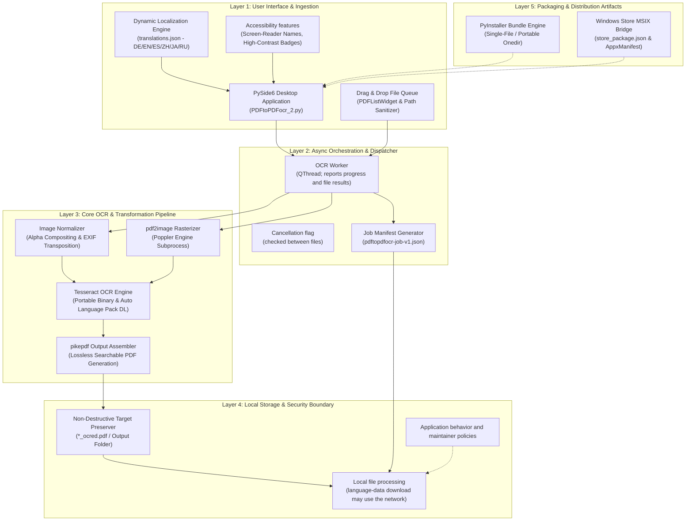

# Archived detailed guide — claim-corrected edition

> Predecessor of [README.md](README.md). Based on source commit 3cfce468f20307bcbc158dd969c3ad304f34b4fe (2026-10-12); this is a corrected archival edition, not an unchanged copy. The original source remains available at [README.md on that commit](https://github.com/doc-bricks/PDFtoPDFocr/blob/3cfce468f20307bcbc158dd969c3ad304f34b4fe/README.md).

---


[English](README.md) | [Deutsch](README_de.md) | [Español](README_es.md) | [中文](README_zh.md) | [日本語](README_ja.md) | [Русский](README_ru.md)

# PDFtoPDFocr - PDF OCR Converter

[](https://www.python.org/)
[](pyproject.toml)
[](LICENSE)
[](https://www.qt.io/)
[](#requirements--platform-matrix)
[](SECURITY.md)
[](#core-features)
[](NOTICE)
[](llms.txt)
[](https://github.com/doc-bricks)
[](https://github.com/open-bricks)

Converts scanned PDF files and raw images into searchable PDFs using local OCR (optical character recognition) with Tesseract. Features multi-format batch processing, selectable OCR language with automatic language pack download, non-destructive original file preservation, accessible UI ergonomics, and portable Tesseract/Poppler integration.

Machine-readable project context: [`llms.txt`](llms.txt) | [Deutsche Dokumentation](README_de.md) | [Security Policy](SECURITY.md)

> [!NOTE]
> **AI & LLM Integration:** This repository contains a structured [`llms.txt`](llms.txt) file providing machine-readable context, architectural details, CLI/GUI interfaces, and test entry points for autonomous agents and developer tooling.

> [!TIP]
> OCR and PDF assembly use local tools. Missing selected Tesseract language data can be downloaded from GitHub; this is not a network-blocking guarantee.

---

## 🧭 Quick Navigation

1. 📸 [Visual Showcase & Interface Overview](#visual-showcase)
2. 🏛️ [System Architecture & 5-Layer Topology](#system-architecture--component-workflow)
3. 🔄 [Local Data Flow & Document OCR Processing Lifecycle](#local-data-flow--privacy-isolation)
4. 🚀 [Quick Start & Key Operations](#quick-start--key-operations)
5. ✨ [Core Features & Performance Capabilities](#core-features)
6. 🎯 [Target Personas & High-Intent Search Intent](#target-personas--discoverability)
7. ⚖️ [10-Dimension Comparative Matrix vs. 5 Alternatives](#comparative-matrix--alternatives)
8. ⌨️ [Accessibility & Keyboard Shortcuts](#accessibility--keyboard-shortcuts)
9. 💻 [Requirements & Platform Matrix](#requirements--platform-matrix)
10. 📦 [Installation & Portable Setup](#installation--portable-setup)
11. 🖥️ [Usage & Execution Guidelines](#usage--execution-guidelines)
12. 🧪 [Automated Testing & Quality Verification](#tests--quality-verification)
13. 🌐 [Sibling Tools & Ecosystem Integration](#sibling-tools--ecosystem)
14. 📜 [Third-Party License Information](#third-party-licenses--transparency)
15. 🔒 [Privacy & Security Model (Invariants)](#privacy--security-model)
16. 🪟 [EXE & Distribution Packaging (Windows Store MSIX & Portable)](#exe--distribution-packaging)
17. 🤖 [Machine-Readable LLM Context (llms.txt)](#machine-readable-llm-context)
18. ⚖️ [Statutory Notice (§ 521 BGB) & License](#statutory-notice--license)

---

<a id="visual-showcase"></a>
<a id="visuelle-showcase-galerie"></a>
## 📸 Visual Showcase & Interface Overview

| Primary Interface | Visual Assets & App Identity |
|:---:|:---:|
| <br/><sub>**Batch Conversion Queue** — Drag-and-drop file ingestion, dynamic language selection, real-time item status badges, and non-blocking worker progress.</sub> | <br/><sub>**High-Resolution App Identity** — Native Windows Store, MSIX package icon set, and accessible contrast palettes.</sub> |

---

<a id="system-architecture--component-workflow"></a>
<a id="systemarchitektur--komponenten-workflow"></a>
## 🏛️ System Architecture & 5-Layer Topology



<a id="four-view-architectural-topology-projection"></a>
<a id="vier-sichten-architektur-topologie-projektion"></a>
### Four-View Architectural Topology Projection

```
+===================================================================================================================+
|                                         PDFtoPDFocr ARCHITECTURE (4 VIEWS)                                        |
+===================================================================================================================+
| [VIEW 1: INGESTION, DRAG-AND-DROP QUEUE & ACCESSIBILITY]                                                          |
|   * PySide6 desktop GUI with a drag-and-drop batch file queue.                                                    |
|   * Accessibility metadata and keyboard navigation are implemented; no independent WCAG audit is claimed.         |
|   * Six-language interface uses translations.json (DE / EN / ES / ZH / JA / RU).                                  |
|   * Child processes inherit caller privileges; the app does not create an isolation boundary.                     |
+-------------------------------------------------------------------------------------------------------------------+
                                                          |
                                                          v
+-------------------------------------------------------------------------------------------------------------------+
| [VIEW 2: OCR WORKER AND JOB STATUS]                                                                               |
|   * QThread workers run OCR outside the GUI thread and emit progress and file results.                            |
|   * Cancellation is checked between files; an active OCR call must return first.                                  |
|   * The application can export a job manifest (pdftopdfocr-job-v1.json).                                          |
|   * Per-page error handling is covered by application tests.                                                      |
+-------------------------------------------------------------------------------------------------------------------+
                                                          |
                                                          v
+-------------------------------------------------------------------------------------------------------------------+
| [VIEW 3: OCR AND PDF OUTPUT]                                                                                      |
|   * Poppler and pdf2image rasterize PDF pages.                                                                    |
|   * Image normalization handles multi-frame TIFF, PNG, and JPG input.                                             |
|   * Tesseract processes pages locally; missing traineddata can be requested from GitHub.                          |
|   * pikepdf assembles searchable PDF output.                                                                      |
+-------------------------------------------------------------------------------------------------------------------+
                                                          |
                                                          v
+-------------------------------------------------------------------------------------------------------------------+
| [VIEW 4: PROCESS AND NETWORK SCOPE]                                                                               |
|   * OCR and PDF assembly use local tools; the language-data request is an external network call.                  |
|   * External tools run as child processes; the application does not sandbox them.                                 |
|   * Project and dependency license information is documented; no bundle-wide audit is claimed.                    |
|   * SECURITY.md lists maintainer response targets and contact details.                                            |
+===================================================================================================================+
```

---

<a id="local-data-flow--privacy-isolation"></a>
<a id="lokaler-datenfluss--datenschutz-isolation"></a>
## 🔄 Local Data Flow & Document OCR Processing Lifecycle

```mermaid
sequenceDiagram
    autonumber
    actor User as User / Batch Operator
    participant GUI as PySide6 Desktop GUI
    participant Worker as Background Worker Thread
    participant Normalizer as Image Normalizer
    participant Poppler as Poppler / pdf2image
    participant Tesseract as Tesseract OCR Engine
    participant Assembler as pikepdf PDF Assembler
    participant FS as Local Filesystem Boundary

    User->>GUI: Add PDF or Image Files (Drag & Drop / File Dialog)
    User->>GUI: Select Target OCR Language (e.g. deu, eng, fra, spa)
    User->>GUI: Trigger Batch Conversion (Ctrl+Return or Button)
    GUI->>Worker: Launch asynchronous conversion task
    loop For Each Document in Queue
        alt Input is Scanned PDF
            Worker->>Poppler: Rasterize PDF pages into memory bitmaps
            Poppler-->>Worker: High-resolution rendered page buffers
        else Input is Direct Image (PNG, JPG, multi-frame TIFF)
            Worker->>Normalizer: Alpha-composite transparency onto white background
            Normalizer-->>Worker: Standardized RGB image frames
        end
        loop For Each Page / Frame
            Worker->>Tesseract: Extract text & bounding boxes via local engine
            Tesseract-->>Worker: Return OCR text & hOCR / PDF layers
        end
        Worker->>Assembler: Inject searchable full-text layer into PDF structure
        Assembler->>FS: Save output as <filename>_ocred.pdf (Non-destructive)
        Worker-->>GUI: Update progress bar & color-coded status badge
    end
    opt Portable Job Manifest Export
        GUI->>FS: Write pdftopdfocr-job-v1.json (job settings and file metadata)
    end
    Note over User,FS: Local OCR/PDF processing; a missing-language-data request may use GitHub
```

---

<a id="quick-start--key-operations"></a>
<a id="schnelleinstieg--kernabläufe"></a>
## 🚀 Quick Start & Key Operations

| Task | Interface / Command | Output / Result |
|---|---|---|
| **Launch Desktop App** | `python PDFtoPDFocr_2.py` or `START.bat` | PySide6 Desktop GUI with drag & drop file queue |
| **Convert Scanned PDFs** | Add files, select language, click "Start" (`Ctrl+Return`) | Non-destructive `*_ocred.pdf` with full-text search layer |
| **Direct Image OCR** | Drop JPG, PNG, or multi-frame TIFF images | Assembled searchable PDF document |
| **Merge into Single PDF** | Enable "Auto-Merge" in toolbar | Consolidated multi-document searchable PDF |
| **Export Job Manifest** | Click "Job-Export" (`Ctrl+E`) | Portable `pdftopdfocr-job-v1.json` manifest |
| **Run Tests** | `python -m pytest` | Run the repository test suite |
| **Portable Build** | `python build_release.py --clean` | Self-contained executable in `dist/PDFtoPDFocr/` |

---

<a id="core-features"></a>
<a id="funktionen--features"></a>
## ✨ Core Features & Performance Capabilities

- **Batch Processing** — Convert multiple PDFs and images simultaneously via file picker or drag & drop.
- **Direct Image Import** — Convert JPG, PNG, and multi-frame TIFF scans directly into searchable PDFs without extra tooling.
- **Selectable OCR Language** — Quick selection for German, English, French, Spanish, and dozens of other languages.
- **Auto-Download** — Missing Tesseract language packs (`.traineddata`) are downloaded automatically on-demand from official GitHub repositories.
- **Auto-Merge & Stacking** — Merge multiple processed OCR results into a single consolidated PDF document.
- **Portable Tesseract & Poppler** — Portable builds (`python build_release.py`) bundle Tesseract and Poppler; when running from source, Tesseract and Poppler must be installed or placed in `tesseract_portable/` and `poppler/` next to the app.
- **Original File Preserved** — Results are saved with the `_ocred.pdf` suffix or in a configured output folder; source files remain untouched.
- **Job Manifest Export** — Save portable `pdftopdfocr-job-v1.json` manifests containing job settings, execution status, and file metadata.
- **Full Accessibility (A11y) & Ergonomics** — Screen-reader accessible names and descriptions across all controls, informative tooltips in active language, and complete keyboard shortcuts (`Ctrl+O`, `Ctrl+Return`, `Ctrl+E`, `F5`, `Ctrl+Shift+O`, `Del`/`Backspace`).
- **High-Contrast Progress** — high-contrast status colors (`#0b6e4f` / `#b45309`) and per-item hover tooltips with real-time status.

---

<a id="target-personas--discoverability"></a>
<a id="zielgruppen--auffindbarkeit"></a>
## 🎯 Intended use and discoverability

### Intended use

This desktop application converts scanned PDFs and images into searchable PDFs. The project does not claim legal, healthcare, or regulatory compliance. Missing selected Tesseract language data may be fetched from GitHub.

---

<a id="comparative-matrix--alternatives"></a>
<a id="vergleichsmatrix--alternativen"></a>
## ⚖️ Comparing tools

This historical vendor matrix lacked current source-checked evidence and is withdrawn. Evaluate alternatives using their current documentation.
---

<a id="accessibility--keyboard-shortcuts"></a>
<a id="barrierefreiheit--tastenkürzel"></a>
## ⌨️ Accessibility & Keyboard Shortcuts

| Action | Shortcut | Description |
|---|---|---|
| **Add Files** | `Ctrl+O` | Open file selector dialog |
| **Start OCR** | `Ctrl+Return` | Start batch OCR processing |
| **Export Job Manifest** | `Ctrl+E` | Export job state as JSON manifest |
| **Clear List & Reset** | `F5` | Reset file list and status display |
| **Select Output Folder** | `Ctrl+Shift+O` | Choose custom output directory |
| **Remove Selected File** | `Del` or `Backspace` | Remove selected item from queue |

---

<a id="requirements--platform-matrix"></a>
<a id="voraussetzungen--plattformmatrix"></a>
## 💻 Requirements & Platform Matrix

- Python 3.10+
- Windows 10/11 (Primary release target)
- macOS / Linux (Source & smoke-test targets)

---

<a id="installation--portable-setup"></a>
<a id="installation--portables-setup"></a>
## 📦 Installation & Portable Setup

```bash
pip install -r requirements.txt
```

Tesseract OCR and Poppler must be available when running from source: either on `PATH` (Tesseract can also be set via `TESSERACT_CMD`) or portable inside the project directory (`tesseract_portable/`, `poppler/`). Missing language packs are downloaded automatically.

---

<a id="usage--execution-guidelines"></a>
<a id="nutzung--ausführungsrichtlinien"></a>
## 🖥️ Usage & Execution Guidelines

```bash
python PDFtoPDFocr_2.py
```

On Windows, `START.bat` also serves as a double-click desktop launcher.

1. Add PDFs or images via file picker or drag & drop.
2. Select OCR language (missing language packs are downloaded automatically).
3. Click "Start" — done.
4. Optionally use `Job-Export` to save a portable `pdftopdfocr-job-v1.json` manifest.

---

<a id="tests--quality-verification"></a>
<a id="tests--qualitätsprüfung"></a>
## 🧪 Automated Testing & Quality Verification

```bash
python -m pip install -r requirements-dev.txt
python -m pytest
```

The test suite covers:
- **UI Accessibility & Shortcuts** (`tests/test_ui_accessibility.py`)
- **Tesseract Configuration** (`tests/test_tesseract_config.py`)
- **Job Export Format & Manifest Schema** (`tests/test_export_format.py`)
- **Language Switching & Multi-Language Support** (`tests/test_language_switch.py`)
- **Bug Regressions & Resource Lifecycle** (`tests/test_bug_regressions.py`)
- **App Icons & Visual Asset Verification** (`tests/test_app_assets.py`)
- **Platform Packaging & Release Validation** (`tests/test_build_release.py`, `tests/test_platform_package_gate.py`)
- **Metadata, Security & Parity Governance** (`tests/test_metadata.py`, `tests/test_security_license_contract.py`)

---

<a id="sibling-tools--ecosystem"></a>
<a id="geschwister-tools--ökosystem"></a>
## 🌐 Sibling Tools & Ecosystem Integration

PDFtoPDFocr is part of the **doc-bricks** document utilities family and the wider **open-bricks** open-source desktop ecosystem:

Related document-oriented repositories in the same organization:

- [DokuReader](https://github.com/doc-bricks/DokuReader)
- [UniversalDocsGrabber](https://github.com/doc-bricks/UniversalDocsGrabber)
- [UniversalInvoiceMail](https://github.com/doc-bricks/UniversalInvoiceMail)

UniversalInvoiceMail is described as offering DATEV-style CSV export, not DATEV certification. These are separate projects; the links do not claim an integration or shared data flow.
---

<a id="third-party-licenses--transparency"></a>
<a id="drittanbieter-lizenzen--transparenz"></a>
## 📜 Third-Party License Information

This repository lists selected dependency and bundled-tool license information. The list is not a complete software bill of materials or a compliance certification:
- License identifiers are provided as an informational inventory; assess obligations for the specific build and distribution.
- The inventory does not determine the obligations of a particular Qt or third-party distribution.
- External tools such as Poppler are invoked as subprocesses; process separation alone does not establish a legal or security boundary.
- The project license is MIT; third-party dependency licenses remain separate and are listed in the inventory.

For selected license information and dependency details, see [`THIRD_PARTY_LICENSES.md`](THIRD_PARTY_LICENSES.md) and [`THIRD_PARTY_LICENSES.txt`](THIRD_PARTY_LICENSES.txt).

---

<a id="privacy--security-model"></a>
<a id="datenschutz--sicherheitsmodell"></a>
## 🔒 Privacy & Security Scope

OCR and PDF assembly use local tools. The application source includes a request for missing Tesseract language data from GitHub. This is not a system-wide network restriction; see [`SECURITY.md`](SECURITY.md) for the maintainer policy and reporting contact.

---

<a id="exe--distribution-packaging"></a>
<a id="exe--distributions-packaging"></a>
## 🪟 EXE & Distribution Packaging (Windows Store MSIX & Portable)

```bash
python build_release.py --clean

# or on Windows via double-click / terminal:
build_exe.bat

# or directly via PyInstaller with dependencies installed:
python -m PyInstaller --noconfirm --clean PDFtoPDFocr.spec
```

The packaged build is written to `dist/PDFtoPDFocr/`. When present, `tesseract_portable/` and `poppler/` are bundled automatically.

---

<a id="machine-readable-llm-context"></a>
<a id="maschinenlesbarer-llm-kontext"></a>
## 🤖 Machine-Readable LLM Context (llms.txt)

For autonomous AI coding agents, pair programmers, and automated CI pipelines, this repository provides a dedicated [`llms.txt`](llms.txt) index following modern LLM context conventions. It includes:
- Architecture summary and component roles
- Testsuite commands and verification gates
- Repository map, security policy, and development commands
- Key files map and dependency matrices

---

<a id="statutory-notice--license"></a>
<a id="contributing--license"></a>
<a id="gesetzlicher-hinweis--lizenz"></a>
<a id="mitwirken--lizenz"></a>
## ⚖️ License and legal note

The project is provided under the MIT license. Whether statutory rules such as section 521 BGB apply depends on the legal relationship and applicable law; this documentation does not establish a blanket exemption from liability.

Contributions, bug reports, and pull requests are welcome! Please ensure all pull requests pass `pytest` and `ruff check .` before submission.

This project is licensed under the [MIT License](LICENSE).
