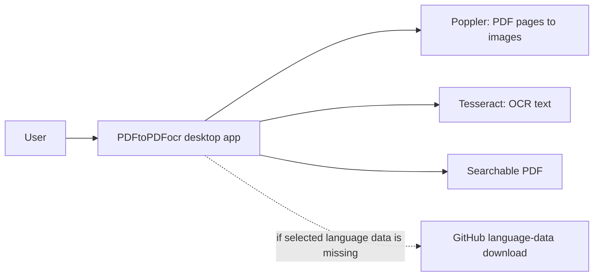

[English](README.md) | [Deutsch](README_de.md) | [Español](README_es.md) | [中文](README_zh.md) | [日本語](README_ja.md) | [Русский](README_ru.md)

# PDFtoPDFocr — searchable PDFs from scans and images

[](https://www.python.org/)
[](pyproject.toml)
[](LICENSE)
[](#requirements--platform-matrix)

PDFtoPDFocr is a desktop application that turns scanned PDFs and image files into searchable PDFs using Tesseract OCR. It supports batch input, selectable OCR languages, and preservation of the original files.

OCR and PDF assembly use local tools. When a selected Tesseract language file is missing, the application can download that file from GitHub. The application does not provide a network-blocking sandbox or firewall.

> This concise entry point replaces the detailed predecessor [README-archive-2026-10-12.md](README-archive-2026-10-12.md). The detailed guide is archived there with current claims corrected; the unmodified source is available at [commit 3cfce468](https://github.com/doc-bricks/PDFtoPDFocr/blob/3cfce468f20307bcbc158dd969c3ad304f34b4fe/README.md).

Machine-readable context: [`llms.txt`](llms.txt) · [Security policy](SECURITY.md) · [Third-party license inventory](THIRD_PARTY_LICENSES.md)

## Quick navigation

1. [Visual showcase](#visual-showcase)
2. [Architecture](#system-architecture--component-workflow)
3. [Local data flow](#local-data-flow--privacy-isolation)
4. [Quick start](#quick-start--key-operations)
5. [Features](#core-features)
6. [Use cases](#target-personas--discoverability)
7. [Comparing tools](#comparative-matrix--alternatives)
8. [Accessibility](#accessibility--keyboard-shortcuts)
9. [Requirements](#requirements--platform-matrix)
10. [Installation](#installation--portable-setup)
11. [Usage](#usage--execution-guidelines)
12. [Related projects](#sibling-tools--ecosystem)
13. [Tests](#tests--quality-verification)
14. [Third-party licenses](#third-party-licenses--transparency)
15. [Privacy and security](#privacy--security-model)
16. [Desktop packaging](#exe--distribution-packaging)
17. [LLM context](#machine-readable-llm-context)
18. [License and legal note](#statutory-notice--license)

<a id="visual-showcase"></a>
<a id="visuelle-showcase-galerie"></a>
## Visual showcase

Screenshots and the detailed interface walkthrough are in the [archived guide](README-archive-2026-10-12.md#visual-showcase).

<a id="system-architecture--component-workflow"></a>
<a id="systemarchitektur--komponenten-workflow"></a>
## Architecture



<a id="four-view-architectural-topology-projection"></a>
<a id="vier-sichten-architektur-topologie-projektion"></a>
### Architecture details

The detailed component and workflow views are in the [archived guide](README-archive-2026-10-12.md#four-view-architectural-topology-projection).

<a id="local-data-flow--privacy-isolation"></a>
<a id="lokaler-datenfluss--datenschutz-isolation"></a>
## Local data flow

PDF processing uses local tools. The source includes a GitHub request to obtain missing Tesseract language data. This describes the application path; it does not establish a system-wide network restriction. See [`SECURITY.md`](SECURITY.md) for the project’s security contact and scope.

<a id="quick-start--key-operations"></a>
<a id="schnelleinstieg--kernabläufe"></a>
## Quick start

```bash
git clone https://github.com/doc-bricks/PDFtoPDFocr.git
cd PDFtoPDFocr
python -m venv .venv
```

Activate the environment using exactly one command for your shell:

PowerShell:

```powershell
.\.venv\Scripts\Activate.ps1
```

Command Prompt:

```bat
.\.venv\Scripts\activate.bat
```

macOS or Linux:

```bash
source .venv/bin/activate
```

Then install the requirements and launch the application:

```bash
python -m pip install -r requirements.txt
python PDFtoPDFocr_2.py
```

The Python wheel built from this repository contains distribution metadata only; it does not install the desktop application. Use this source checkout to run the app.

Install Tesseract OCR and Poppler separately; see [requirements](#requirements--platform-matrix). On Windows, `START.bat` is also available.

<a id="core-features"></a>
<a id="funktionen--features"></a>
## Features

- Process scanned PDF and image inputs in batches.
- Select an OCR language; missing Tesseract language data can be downloaded from GitHub.
- Create searchable PDF output while keeping source files intact.
- Export a job manifest from the application.

See the [archived feature guide](README-archive-2026-10-12.md#core-features) for the detailed walkthrough.

<a id="target-personas--discoverability"></a>
<a id="zielgruppen--auffindbarkeit"></a>
## Use cases

The application is intended for desktop workflows that convert scans or images into searchable PDFs. It is not a legal, medical, or compliance certification.

<a id="comparative-matrix--alternatives"></a>
<a id="vergleichsmatrix--alternativen"></a>
## Comparing tools

We do not maintain a verified feature or compliance comparison with other products. Evaluate alternatives using their current documentation and your own requirements.

<a id="accessibility--keyboard-shortcuts"></a>
<a id="barrierefreiheit--tastenkürzel"></a>
## Accessibility

The application includes keyboard shortcuts and accessibility metadata. No independent WCAG conformance audit is claimed. See the [detailed UI notes](README-archive-2026-10-12.md#accessibility--keyboard-shortcuts).

<a id="requirements--platform-matrix"></a>
<a id="voraussetzungen--plattformmatrix"></a>
## Requirements

Source runs require Python 3.10 or newer. The declared Python package minimums are:

| Package | Minimum version |
| --- | ---: |
| PySide6 | 6.5.0 |
| pytesseract | 0.3.13 |
| Pillow | 10.4.0 |
| pdf2image | 1.17.0 |
| pikepdf | 8.15.1 |
| requests | 2.33.1 |

The same requirements are listed in `requirements.txt` and `pyproject.toml`. Tesseract OCR and Poppler must also be available on `PATH` or configured through the supported local paths. Windows is the primary packaged target; macOS and Linux are source-run targets.

<a id="installation--portable-setup"></a>
<a id="installation--portables-setup"></a>
## Installation

Clone the repository and install the Python requirements listed in `requirements.txt` into the active virtual environment. Native tools Tesseract and Poppler must be installed separately. Missing selected language data may be downloaded from GitHub at runtime.

<a id="usage--execution-guidelines"></a>
<a id="nutzung--ausführungsrichtlinien"></a>
## Usage

1. Start `python PDFtoPDFocr_2.py` or use `START.bat` on Windows.
2. Add PDF or image files and choose an OCR language.
3. Start OCR and review the searchable PDF output.
4. Use the application’s job export if you need a portable job manifest.

<a id="tests--quality-verification"></a>
<a id="tests--qualitätsprüfung"></a>
## Tests

With the virtual environment active, install development dependencies using `python -m pip install -r requirements-dev.txt`; this file includes `requirements.txt`, pytest, and ruff. Run `python -m pytest`. The repository also provides `python manage_translations.py --check` for translation consistency.

<a id="sibling-tools--ecosystem"></a>
<a id="geschwister-tools--ökosystem"></a>
## Related projects

| Project | Adjacent task |
| --- | --- |
| [DokuReader](https://github.com/doc-bricks/DokuReader) | Local document library and PDF organization. |
| [UniversalDocsGrabber](https://github.com/doc-bricks/UniversalDocsGrabber) | Downloading email attachments and organizing documents on Windows. |
| [UniversalInvoiceMail](https://github.com/doc-bricks/UniversalInvoiceMail) | Invoice extraction and DATEV-style CSV export. |

These are separate projects; the links describe adjacent tasks, not a shared runtime or data flow.

<a id="third-party-licenses--transparency"></a>
<a id="drittanbieter-lizenzen--transparenz"></a>
## Third-party licenses

[`THIRD_PARTY_LICENSES.md`](THIRD_PARTY_LICENSES.md) and [`THIRD_PARTY_LICENSES.txt`](THIRD_PARTY_LICENSES.txt) list selected dependency and bundled-tool license information. They are an informational inventory, not a certification of compliance for every distribution or use.

<a id="privacy--security-model"></a>
<a id="datenschutz--sicherheitsmodell"></a>
## Privacy and security

The application uses local OCR and PDF tools, and its source includes a request for missing Tesseract language data. It does not provide a firewall, sandbox, or operating-system privilege boundary. See [`PRIVACY_POLICY.md`](PRIVACY_POLICY.md) for data-flow details and [`SECURITY.md`](SECURITY.md) for the maintainer’s reporting policy.

<a id="exe--distribution-packaging"></a>
<a id="exe--distributions-packaging"></a>
## Desktop packaging

A local Windows build can be prepared with `python build_release.py --clean` or `build_exe.bat`. The `--clean` option removes `dist/`, `build/`, and `.build_venv/` before creating a fresh build environment and running PyInstaller. The script uses its own build dependency list. It creates local artifacts and does not publish a release.

<a id="machine-readable-llm-context"></a>
<a id="maschinenlesbarer-llm-kontext"></a>
## LLM context

[`llms.txt`](llms.txt) is a short machine-readable index of repository files and development commands.

<a id="statutory-notice--license"></a>
<a id="contributing--license"></a>
<a id="gesetzlicher-hinweis--lizenz"></a>
<a id="mitwirken--lizenz"></a>
## License and legal note

The project is provided under the [MIT license](LICENSE). Whether statutory rules such as section 521 BGB apply depends on the legal relationship and applicable law; this documentation does not provide a blanket exemption from liability.
