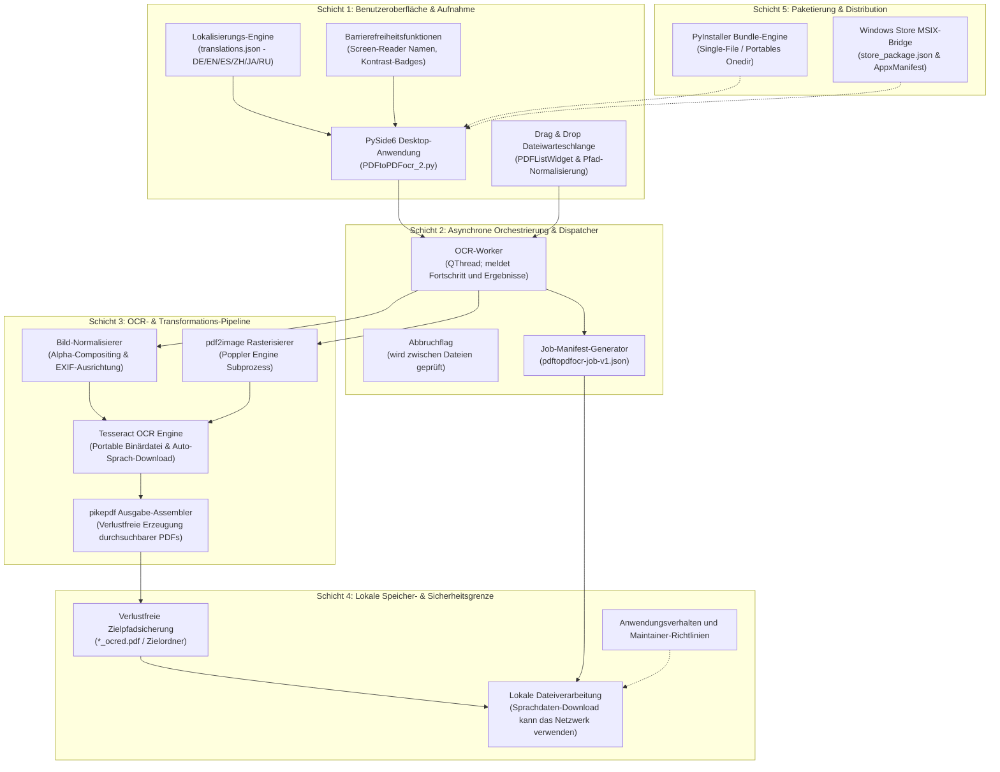

# Archivierte ausführliche Anleitung — korrigierte Fassung

> Vorgänger von [README_de.md](README_de.md). Basiert auf Commit 3cfce468f20307bcbc158dd969c3ad304f34b4fe (2026-10-12); dies ist eine korrigierte Archivfassung, keine unveränderte Kopie. Die ursprüngliche Fassung ist unter [README_de.md in diesem Commit](https://github.com/doc-bricks/PDFtoPDFocr/blob/3cfce468f20307bcbc158dd969c3ad304f34b4fe/README_de.md) verfügbar.

---


[English](README.md) | [Deutsch](README_de.md) | [Español](README_es.md) | [中文](README_zh.md) | [日本語](README_ja.md) | [Русский](README_ru.md)

# PDFtoPDFocr - PDF-OCR-Konverter

[](https://www.python.org/)
[](pyproject.toml)
[](LICENSE)
[](https://www.qt.io/)
[](#voraussetzungen--plattformmatrix)
[](SECURITY.md)
[](#funktionen--features)
[](NOTICE)
[](llms.txt)
[](https://github.com/doc-bricks)
[](https://github.com/open-bricks)

Wandelt gescannte PDF-Dateien und Bilddokumente in durchsuchbare PDFs um: per lokaler OCR (optische Zeichenerkennung) mit Tesseract. Bietet Mehrformat-Stapelverarbeitung, auswählbare OCR-Sprache mit automatischem Sprachpaket-Download, verlustfreien Erhalt der Originaldateien, barrierefreie Benutzeroberfläche und portable Tesseract/Poppler-Integration.

Maschinenlesbarer Projektkontext: [`llms.txt`](llms.txt) | [English Documentation](README.md) | [Sicherheitsrichtlinie](SECURITY.md)

> [!NOTE]
> **KI & LLM-Integration:** Dieses Repository enthält eine strukturierte [`llms.txt`](llms.txt)-Datei mit maschinenlesbarem Kontext, Architektur-Details, CLI/GUI-Schnittstellen und Test-Einstiegspunkten für autonome KI-Agenten und Entwickler-Workflows.

> [!TIP]
> OCR und PDF-Erstellung verwenden lokale Werkzeuge. Fehlende ausgewählte Tesseract-Sprachdaten können von GitHub geladen werden; dies ist keine Garantie einer Netzwerksperre.

---

## 🧭 Schnellnavigation

1. 📸 [Visuelle Showcase-Galerie & Benutzeroberfläche](#visuelle-showcase-galerie)
2. 🏛️ [Systemarchitektur & 5-Schichten-Topologie](#systemarchitektur--komponenten-workflow)
3. 🔄 [Lokaler Datenfluss & Dokument-OCR-Verarbeitungslebenszyklus](#lokaler-datenfluss--datenschutz-isolation)
4. 🚀 [Schnelleinstieg & Kernabläufe](#schnelleinstieg--kernabläufe)
5. ✨ [Funktionen & Leistungsmerkmale](#funktionen--features)
6. 🎯 [Zielgruppen & Auffindbarkeit](#zielgruppen--auffindbarkeit)
7. ⚖️ [10-Dimensionen-Vergleichsmatrix vs. 5 Alternativen](#vergleichsmatrix--alternativen)
8. ⌨️ [Barrierefreiheit und Tastenkürzel](#barrierefreiheit--tastenkürzel)
9. 💻 [Voraussetzungen & Plattformmatrix](#voraussetzungen--plattformmatrix)
10. 📦 [Installation & Portables Setup](#installation--portables-setup)
11. 🖥️ [Nutzung & Ausführungsrichtlinien](#nutzung--ausführungsrichtlinien)
12. 🧪 [Automatisierte Tests & Qualitätsprüfung](#tests--qualitätsprüfung)
13. 🌐 [Geschwister-Tools & Ökosystem-Integration](#geschwister-tools--ökosystem)
14. 📜 [Drittanbieter-Lizenzinformationen](#drittanbieter-lizenzen--transparenz)
15. 🔒 [Datenschutz- & Sicherheitsmodell (Invarianten)](#datenschutz--sicherheitsmodell)
16. 🪟 [EXE & Distributions-Packaging (Windows Store MSIX & Portable)](#exe--distributions-packaging)
17. 🤖 [Maschinenlesbarer LLM-Kontext (llms.txt)](#maschinenlesbarer-llm-kontext)
18. ⚖️ [Gesetzlicher Hinweis (§ 521 BGB) & Lizenz](#gesetzlicher-hinweis--lizenz)

---

<a id="visuelle-showcase-galerie"></a>
<a id="visual-showcase"></a>
## 📸 Visuelle Showcase-Galerie & Benutzeroberfläche

| Hauptansicht | App-Identität & Assets |
|:---:|:---:|
| <br/><sub>**Batch-Warteschlange** – Drag-and-Drop Dateiaufnahme, dynamische Sprachauswahl, farbcodierte Status-Badges und asynchroner Arbeitsfortschritt.</sub> | <br/><sub>**App-Identität** – Windows Store und MSIX-Paket-Asset-Set mit barrierefreien Farbpaletten.</sub> |

---

<a id="systemarchitektur--komponenten-workflow"></a>
<a id="system-architecture--component-workflow"></a>
## 🏛️ Systemarchitektur & 5-Schichten-Topologie



<a id="vier-sichten-architektur-topologie-projektion"></a>
<a id="four-view-architectural-topology-projection"></a>
### Vier-Sichten Architektur-Topologie Projektion

```
+===================================================================================================================+
|                                        PDFtoPDFocr ARCHITEKTUR (4 SICHTEN)                                        |
+===================================================================================================================+
| [SICHT 1: AUFNAHME, DRAG-AND-DROP-WARTESCHLANGE & BARRIEREFREIHEIT]                                               |
|   * PySide6-Desktop-GUI mit Drag-and-drop-Warteschlange für mehrere Dateien.                                      |
|   * Barrierefreiheits-Metadaten und Tastaturnavigation sind umgesetzt; ein unabhängiges WCAG-Audit wird nicht     |
|     behauptet.                                                                                                    |
|   * Die Oberfläche nutzt translations.json für sechs Sprachen (DE / EN / ES / ZH / JA / RU).                      |
|   * Kindprozesse erben die Rechte des aufrufenden Prozesses; die App bildet keine Isolationsgrenze.               |
+-------------------------------------------------------------------------------------------------------------------+
                                                          |
                                                          v
+-------------------------------------------------------------------------------------------------------------------+
| [SICHT 2: OCR-WORKER UND JOBSTATUS]                                                                               |
|   * QThread-Worker führen OCR außerhalb des GUI-Threads aus und senden Fortschritt und Dateiergebnisse.           |
|   * Ein Abbruch wird zwischen Dateien geprüft; ein laufender OCR-Aufruf muss zuerst zurückkehren.                 |
|   * Die Anwendung kann ein Jobmanifest (pdftopdfocr-job-v1.json) exportieren.                                     |
|   * Die Anwendungstests decken die Fehlerbehandlung pro Seite ab.                                                 |
+-------------------------------------------------------------------------------------------------------------------+
                                                          |
                                                          v
+-------------------------------------------------------------------------------------------------------------------+
| [SICHT 3: OCR UND PDF-AUSGABE]                                                                                    |
|   * Poppler und pdf2image rasterisieren PDF-Seiten.                                                               |
|   * Die Bildnormalisierung verarbeitet mehrseitige TIFF-, PNG- und JPG-Eingaben.                                  |
|   * Tesseract verarbeitet Seiten lokal; fehlende Sprachdaten können von GitHub angefordert werden.                |
|   * pikepdf erstellt die durchsuchbare PDF-Ausgabe.                                                               |
+-------------------------------------------------------------------------------------------------------------------+
                                                          |
                                                          v
+-------------------------------------------------------------------------------------------------------------------+
| [SICHT 4: PROZESS- UND NETZWERKUMFANG]                                                                            |
|   * OCR und PDF-Erstellung nutzen lokale Werkzeuge; die Sprachdatenanfrage greift extern auf das Netzwerk zu.     |
|   * Externe Werkzeuge laufen als Kindprozesse; die Anwendung isoliert sie nicht in einer Sandbox.                 |
|   * Projekt- und Drittanbieter-Lizenzinformationen sind dokumentiert; ein Gesamtbundle-Audit wird nicht           |
|     behauptet.                                                                                                    |
|   * SECURITY.md nennt Kontakt und Reaktionsziele der Maintainer.                                                  |
+===================================================================================================================+
```

---

<a id="lokaler-datenfluss--datenschutz-isolation"></a>
<a id="local-data-flow--privacy-isolation"></a>
## 🔄 Lokaler Datenfluss & Dokument-OCR-Verarbeitungslebenszyklus

```mermaid
sequenceDiagram
    autonumber
    actor User as Benutzer / Batch-Operator
    participant GUI as PySide6 Desktop GUI
    participant Worker as Hintergrund Worker-Thread
    participant Normalizer as Bild-Normalisierer
    participant Poppler as Poppler / pdf2image
    participant Tesseract as Tesseract OCR Engine
    participant Assembler as pikepdf PDF-Assembler
    participant FS as Lokale Dateisystemgrenze

    User->>GUI: PDF- oder Bilddateien hinzufügen (Drag & Drop / Dateidialog)
    User->>GUI: OCR-Zielsprache auswählen (z.B. deu, eng, fra, spa)
    User->>GUI: Stapelverarbeitung starten (Strg+Eingabetaste oder Button)
    GUI->>Worker: Asynchrone Konvertierungsaufgabe starten
    loop Für jedes Dokument in der Warteschlange
        alt Eingabe ist gescannte PDF
            Worker->>Poppler: PDF-Seiten in Arbeitsspeicher-Bitmaps rasterisieren
            Poppler-->>Worker: Hochauflösende gerenderte Seitenpuffer
        else Eingabe ist Direktbild (PNG, JPG, mehrseitiges TIFF)
            Worker->>Normalizer: Alpha-Kanal auf weißem Hintergrund zusammensetzen
            Normalizer-->>Worker: Standardisierte RGB-Bildframes
        end
        loop Für jede Seite / Frame
            Worker->>Tesseract: Textextraktion & Bounding-Boxes via lokaler Engine
            Tesseract-->>Worker: OCR-Text & hOCR / PDF-Ebenen zurückgeben
        end
        Worker->>Assembler: Durchsuchbare Volltext-Ebene in PDF-Struktur einbetten
        Assembler->>FS: Ausgabe als <dateiname>_ocred.pdf speichern (Verlustfrei)
        Worker-->>GUI: Fortschrittsbalken & Farbstatus-Badge aktualisieren
    end
    opt Portabler Job-Manifest-Export
        GUI->>FS: pdftopdfocr-job-v1.json schreiben (0 rohe Dokumenten-Bytes)
    end
    Note over User,FS: Lokale OCR/PDF-Verarbeitung; fehlende Sprachdaten können von GitHub geladen werden
```

---

<a id="schnelleinstieg--kernabläufe"></a>
<a id="quick-start--key-operations"></a>
## 🚀 Schnelleinstieg & Kernabläufe

| Aufgabe | Schnittstelle / Befehl | Ausgabe / Ergebnis |
|---|---|---|
| **Desktop-App starten** | `python PDFtoPDFocr_2.py` oder `START.bat` | PySide6 Desktop-GUI mit Drag & Drop Warteschlange |
| **Gescannte PDFs umwandeln** | Dateien hinzufügen, Sprache wählen, "Start" (`Strg+Eingabetaste`) | Verlustfreie `*_ocred.pdf` mit Volltext-Suchlayer |
| **Direkte Bild-OCR** | JPG, PNG oder mehrseitige TIFF-Dateien hineinziehen | Zusammengefügtes durchsuchbares PDF-Dokument |
| **In Sammel-PDF vereinen** | "Auto-Merge" in Menüleiste aktivieren | Konsolidierte mehrseitige durchsuchbare Sammel-PDF |
| **Job-Manifest exportieren** | Klick auf "Job-Export" (`Strg+E`) | Portables `pdftopdfocr-job-v1.json` Manifest |
| **Testsuite ausführen** | `python -m pytest` | Führt die Testsuite des Repositories aus |
| **Portablen Build erzeugen** | `python build_release.py --clean` | Eigenständige ausführbare Datei in `dist/PDFtoPDFocr/` |

---

<a id="funktionen--features"></a>
<a id="core-features"></a>
## ✨ Funktionen & Leistungsmerkmale

- **Batch-Verarbeitung** – Mehrere PDFs und Bilder gleichzeitig konvertieren (Dateiauswahl oder Drag & Drop).
- **Direkter Bild-Import** – JPG, PNG und mehrseitige TIFF-Dateien direkt ohne Zwischenschritte per OCR in durchsuchbare PDFs umwandeln.
- **Auswählbare OCR-Sprache** – Schnellwahl für Deutsch, Englisch, Französisch, Spanisch und dutzende weitere Sprachen.
- **Auto-Download** – Fehlende Tesseract-Sprachpakete (`.traineddata`) werden bei Bedarf automatisch von offiziellen GitHub-Repositories geladen.
- **Auto-Merge & Stapeln** – Mehrere verarbeitete OCR-Ergebnisse zu einer konsolidierten Sammel-PDF zusammenfassen.
- **Portable Tesseract & Poppler** – Portable Builds (`python build_release.py`) bündeln Tesseract und Poppler; beim Start aus dem Quellcode müssen Tesseract und Poppler installiert sein oder in `tesseract_portable/` und `poppler/` neben der App liegen.
- **Verlustfreier Originaldateischutz** – Ergebnisse werden standardmäßig mit dem Suffix `_ocred.pdf` oder im Zielordner abgelegt; Originale bleiben unberührt.
- **Job-Manifest-Export** – Speichert portable `pdftopdfocr-job-v1.json`-Dateien mit Einstellungen, Status und Metadaten.
- **Vollständige Barrierefreiheit (A11y)** – Screen-Reader-gerechte Bezeichnungen aller Steuerelemente, Tooltips in aktiver Sprache und vollständige Tastaturkürzel (`Strg+O`, `Strg+Eingabetaste`, `Strg+E`, `F5`, `Strg+Umschalt+O`, `Entf`/`Rücktaste`).
- **Kontrastreicher Fortschritt** – kontrastreiche Statusfarben (`#0b6e4f` / `#b45309`) und Einzeldateistatus per Mouseover.

---

<a id="zielgruppen--auffindbarkeit"></a>
<a id="target-personas--discoverability"></a>
## 🎯 Einsatzbereich und Auffindbarkeit

### Einsatzbereich

Diese Desktop-Anwendung wandelt gescannte PDFs und Bilder in durchsuchbare PDFs um. Das Projekt behauptet keine rechtliche, medizinische oder regulatorische Compliance. Fehlende ausgewählte Tesseract-Sprachdaten können von GitHub geladen werden.

---

<a id="vergleichsmatrix--alternativen"></a>
<a id="comparative-matrix--alternatives"></a>
## ⚖️ Produktvergleich

Diese historische Produktmatrix beruhte nicht auf aktuell quellengeprüften Belegen und wird zurückgezogen. Prüfen Sie Alternativen anhand ihrer aktuellen Dokumentation.
---

<a id="barrierefreiheit--tastenkürzel"></a>
<a id="accessibility--keyboard-shortcuts"></a>
## ⌨️ Barrierefreiheit und Tastenkürzel

| Aktion | Tastenkürzel | Beschreibung |
|---|---|---|
| **Dateien hinzufügen** | `Strg+O` | Dateiauswahldialog öffnen |
| **OCR starten** | `Strg+Eingabetaste` | Stapel-OCR-Verarbeitung beginnen |
| **Job-Manifest exportieren** | `Strg+E` | Auftragszustand als JSON-Manifest speichern |
| **Liste zurücksetzen** | `F5` | Dateiliste leeren und Statusanzeige zurücksetzen |
| **Ausgabeordner wählen** | `Strg+Umschalt+O` | Benutzerdefinierten Zielordner festlegen |
| **Ausgewählte Datei entfernen**| `Entf` oder `Rücktaste` | Gewählte Datei aus der Warteschlange entfernen |

---

<a id="voraussetzungen--plattformmatrix"></a>
<a id="requirements--platform-matrix"></a>
## 💻 Voraussetzungen & Plattformmatrix

- Python 3.10+
- Windows 10/11 (Primäre Distributions-Plattform)
- macOS / Linux (Ausführung aus Quellcode)

---

<a id="installation--portables-setup"></a>
<a id="installation--portable-setup"></a>
## 📦 Installation & Portables Setup

```bash
pip install -r requirements.txt
```

Beim Start aus dem Quellcode müssen Tesseract OCR und Poppler verfügbar sein: entweder im System-`PATH` (Tesseract alternativ über `TESSERACT_CMD`) oder portabel im Projektverzeichnis (`tesseract_portable/`, `poppler/`). Fehlende Sprachpakete werden automatisch nachgeladen.

---

<a id="nutzung--ausführungsrichtlinien"></a>
<a id="usage--execution-guidelines"></a>
## 🖥️ Nutzung & Ausführungsrichtlinien

```bash
python PDFtoPDFocr_2.py
```

Unter Windows kann `START.bat` per Doppelklick als Direktstarter genutzt werden.

1. PDFs oder Bilder per Dateiauswahl oder Drag & Drop hinzufügen.
2. OCR-Sprache wählen (fehlende Sprachpakete werden automatisch geladen).
3. Auf "Start" klicken – fertig.
4. Optional per "Job-Export" ein portables `pdftopdfocr-job-v1.json`-Manifest sichern.

---

<a id="tests--qualitätsprüfung"></a>
<a id="tests--quality-verification"></a>
## 🧪 Automatisierte Tests & Qualitätsprüfung

```bash
python -m pip install -r requirements-dev.txt
python -m pytest
```

Die Testsuite deckt ab:
- **UI-Barrierefreiheit & Tastenkürzel** (`tests/test_ui_accessibility.py`)
- **Tesseract-Konfiguration** (`tests/test_tesseract_config.py`)
- **Job-Exportformat & Manifest-Schema** (`tests/test_export_format.py`)
- **Sprachumschaltung & Mehrsprachigkeit** (`tests/test_language_switch.py`)
- **Fehler-Regressionen & Ressourcen-Lebenszyklus** (`tests/test_bug_regressions.py`)
- **App-Icons & Bild-Assets** (`tests/test_app_assets.py`)
- **Plattform-Paketierung & Release-Validierung** (`tests/test_build_release.py`, `tests/test_platform_package_gate.py`)
- **Metadaten, Sicherheit & Paritäts-Governance** (`tests/test_metadata.py`, `tests/test_security_license_contract.py`)

---

<a id="geschwister-tools--ökosystem"></a>
<a id="sibling-tools--ecosystem"></a>
## 🌐 Geschwister-Tools & Ökosystem-Integration

PDFtoPDFocr ist Teil der **doc-bricks** Dokumenten-Werkzeugfamilie und des **open-bricks** Open-Source-Ökosystems:

Verwandte dokumentenorientierte Repositories derselben Organisation:

- [DokuReader](https://github.com/doc-bricks/DokuReader)
- [UniversalDocsGrabber](https://github.com/doc-bricks/UniversalDocsGrabber)
- [UniversalInvoiceMail](https://github.com/doc-bricks/UniversalInvoiceMail)

UniversalInvoiceMail wird als DATEV-ähnlicher CSV-Export beschrieben, nicht als DATEV-Zertifizierung. Es sind eigenständige Projekte; die Links behaupten weder eine Integration noch einen gemeinsamen Datenfluss.
---

<a id="drittanbieter-lizenzen--transparenz"></a>
<a id="third-party-licenses--transparency"></a>
## 📜 Drittanbieter-Lizenzinformationen

Dieses Repository listet ausgewählte Lizenzinformationen zu Abhängigkeiten und gebündelten Werkzeugen. Die Liste ist weder ein vollständiges Software-Inventar noch eine Compliance-Zertifizierung:
- Lizenzkennungen dienen der Information; Pflichten sind für die konkrete Version und Verteilung zu prüfen.
- Das Inventar entscheidet nicht über Pflichten für eine konkrete Qt- oder Drittanbieter-Verteilung.
- Externe Werkzeuge wie Poppler werden als Subprozesse gestartet; die Prozessgrenze allein begründet keine rechtliche oder Sicherheitsisolation.
- Die Projektlizenz ist MIT; Lizenzen von Drittanbieter-Abhängigkeiten bleiben eigenständig und stehen im Inventar.

Ausgewählte Lizenz- und Abhängigkeitsinformationen stehen in [`THIRD_PARTY_LICENSES.md`](THIRD_PARTY_LICENSES.md) und [`THIRD_PARTY_LICENSES.txt`](THIRD_PARTY_LICENSES.txt).

---

<a id="datenschutz--sicherheitsmodell"></a>
<a id="privacy--security-model"></a>
## 🔒 Datenschutz und Sicherheit: Geltungsbereich

OCR und PDF-Erstellung verwenden lokale Werkzeuge. Der Anwendungscode enthält eine Anfrage für fehlende Tesseract-Sprachdaten von GitHub. Das ist keine systemweite Netzwerksperre; Maintainer-Richtlinie und Meldestelle stehen in [`SECURITY.md`](SECURITY.md).

---

<a id="exe--distributions-packaging"></a>
<a id="exe--distribution-packaging"></a>
## 🪟 EXE & Distributions-Packaging (Windows Store MSIX & Portable)

```bash
python build_release.py --clean

# oder unter Windows per Doppelklick / Konsole:
build_exe.bat

# oder direkt per PyInstaller:
python -m PyInstaller --noconfirm --clean PDFtoPDFocr.spec
```

Das fertige Paket wird in `dist/PDFtoPDFocr/` erzeugt. Falls vorhanden, werden `tesseract_portable/` und `poppler/` automatisch eingebunden.

---

<a id="maschinenlesbarer-llm-kontext"></a>
<a id="machine-readable-llm-context"></a>
## 🤖 Maschinenlesbarer LLM-Kontext (llms.txt)

Für autonome KI-Programmierassistenten und automatisierte CI-Pipelines stellt dieses Repository eine dedizierte [`llms.txt`](llms.txt)-Datei nach modernen Konventionen bereit. Sie enthält:
- Architektur-Zusammenfassung und Komponenten-Rollen
- Testbefehle und Verifikations-Gates
- Projektübersicht, Sicherheitsrichtlinie und Entwicklungsbefehle
- Dateisystem-Übersicht und Abhängigkeits-Matrizen

---

<a id="gesetzlicher-hinweis--lizenz"></a>
<a id="mitwirken--lizenz"></a>
<a id="statutory-notice--license"></a>
<a id="contributing--license"></a>
## ⚖️ Lizenz und Rechtshinweis

Das Projekt steht unter der MIT-Lizenz. Ob gesetzliche Vorschriften wie § 521 BGB anwendbar sind, hängt vom konkreten Rechtsverhältnis und dem anwendbaren Recht ab; diese Dokumentation begründet keine pauschale Haftungsfreistellung.

Beiträge, Fehlermeldungen und Pull Requests sind willkommen! Bitte stellen Sie sicher, dass alle Pull Requests vor dem Einreichen die Testsuite (`pytest`) und den Linter (`ruff check .`) erfolgreich durchlaufen.

Dieses Projekt steht unter der [MIT-Lizenz](LICENSE).
