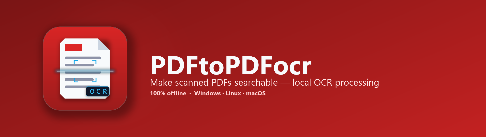
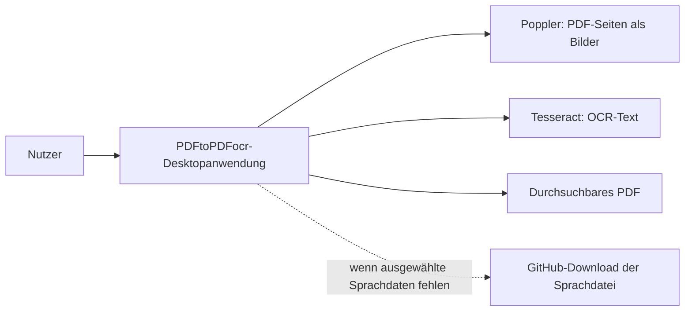

[English](README.md) | [Deutsch](README_de.md) | [Español](README_es.md) | [中文](README_zh.md) | [日本語](README_ja.md) | [Русский](README_ru.md)

# PDFtoPDFocr — durchsuchbare PDFs aus Scans und Bildern

[](https://www.python.org/)
[](pyproject.toml)
[](LICENSE)
[](#voraussetzungen--plattformmatrix)

PDFtoPDFocr ist eine Desktop-Anwendung, die gescannte PDFs und Bilddateien mit Tesseract-OCR in durchsuchbare PDFs umwandelt. Sie unterstützt Stapelverarbeitung, wählbare OCR-Sprachen und den Erhalt der Quelldateien.

OCR und PDF-Erstellung verwenden lokale Werkzeuge. Fehlt eine ausgewählte Tesseract-Sprachdatei, kann die Anwendung sie von GitHub herunterladen. Die Anwendung stellt keine netzwerksperrende Sandbox oder Firewall bereit.

> Diese kompakte Einstiegsseite ersetzt die ausführliche Vorgängerdatei [README_de-archive-2026-10-12.md](README_de-archive-2026-10-12.md). Die Detailanleitung ist dort mit korrigierten aktuellen Aussagen archiviert; die unveränderte Quelle steht unter [Commit 3cfce468](https://github.com/doc-bricks/PDFtoPDFocr/blob/3cfce468f20307bcbc158dd969c3ad304f34b4fe/README_de.md).

Maschinenlesbarer Kontext: [`llms.txt`](llms.txt) · [Sicherheitsrichtlinie](SECURITY.md) · [Drittanbieter-Lizenzinventar](THIRD_PARTY_LICENSES.md)

## Schnellnavigation

1. [Visuelle Übersicht](#visual-showcase)
2. [Architektur](#systemarchitektur--komponenten-workflow)
3. [Lokaler Datenfluss](#lokaler-datenfluss--datenschutz-isolation)
4. [Schnelleinstieg](#schnelleinstieg--kernabläufe)
5. [Funktionen](#funktionen--features)
6. [Einsatzmöglichkeiten](#zielgruppen--auffindbarkeit)
7. [Produktvergleich](#vergleichsmatrix--alternativen)
8. [Barrierefreiheit](#barrierefreiheit--tastenkürzel)
9. [Voraussetzungen](#voraussetzungen--plattformmatrix)
10. [Installation](#installation--portables-setup)
11. [Nutzung](#nutzung--ausführungsrichtlinien)
12. [Verwandte Projekte](#geschwister-tools--ökosystem)
13. [Tests](#tests--qualitätsprüfung)
14. [Drittanbieter-Lizenzen](#drittanbieter-lizenzen--transparenz)
15. [Datenschutz und Sicherheit](#datenschutz--sicherheitsmodell)
16. [Desktop-Paketierung](#exe--distributions-packaging)
17. [LLM-Kontext](#maschinenlesbarer-llm-kontext)
18. [Lizenz und Rechtshinweis](#gesetzlicher-hinweis--lizenz)

<a id="visual-showcase"></a>
<a id="visuelle-showcase-galerie"></a>
## Visuelle Übersicht

Screenshots und die ausführliche Oberflächenbeschreibung stehen in der [archivierten Anleitung](README_de-archive-2026-10-12.md#visuelle-showcase-galerie).

<a id="system-architecture--component-workflow"></a>
<a id="systemarchitektur--komponenten-workflow"></a>
## Architektur



<a id="four-view-architectural-topology-projection"></a>
<a id="vier-sichten-architektur-topologie-projektion"></a>
### Architekturdetails

Die ausführlichen Komponenten- und Ablaufansichten stehen in der [archivierten Anleitung](README_de-archive-2026-10-12.md#vier-sichten-architektur-topologie-projektion).

<a id="local-data-flow--privacy-isolation"></a>
<a id="lokaler-datenfluss--datenschutz-isolation"></a>
## Lokaler Datenfluss

Die PDF-Verarbeitung verwendet lokale Werkzeuge. Der Quellcode enthält eine GitHub-Anfrage zum Abruf fehlender Tesseract-Sprachdaten. Das beschreibt den Anwendungspfad, keine systemweite Netzwerksperre. Kontakt und Geltungsbereich der Sicherheitsrichtlinie stehen in [`SECURITY.md`](SECURITY.md).

<a id="quick-start--key-operations"></a>
<a id="schnelleinstieg--kernabläufe"></a>
## Schnelleinstieg

```bash
git clone https://github.com/doc-bricks/PDFtoPDFocr.git
cd PDFtoPDFocr
python -m venv .venv
```

Aktivieren Sie die Umgebung mit genau einem passenden Befehl für Ihre Shell:

PowerShell:

```powershell
.\.venv\Scripts\Activate.ps1
```

Eingabeaufforderung:

```bat
.\.venv\Scripts\activate.bat
```

macOS oder Linux:

```bash
source .venv/bin/activate
```

Installieren Sie danach die Abhängigkeiten und starten Sie die Anwendung:

```bash
python -m pip install -r requirements.txt
python PDFtoPDFocr_2.py
```

Das aus diesem Repository gebaute Python-Wheel enthält nur Distributionsmetadaten; es installiert die Desktopanwendung nicht. Verwenden Sie diesen Quellcheckout, um die App auszuführen.

Tesseract OCR und Poppler müssen separat installiert werden; siehe [Voraussetzungen](#voraussetzungen--plattformmatrix). Unter Windows steht zusätzlich `START.bat` bereit.

<a id="core-features"></a>
<a id="funktionen--features"></a>
## Funktionen

- Gescannte PDFs und Bilder stapelweise verarbeiten.
- OCR-Sprache auswählen; fehlende Tesseract-Sprachdaten können von GitHub geladen werden.
- Durchsuchbare PDFs erstellen und Quelldateien erhalten.
- Ein Jobmanifest aus der Anwendung exportieren.

Die [archivierte Funktionsübersicht](README_de-archive-2026-10-12.md#funktionen--features) enthält den ausführlichen Ablauf.

<a id="target-personas--discoverability"></a>
<a id="zielgruppen--auffindbarkeit"></a>
## Einsatzmöglichkeiten

Die Anwendung ist für Desktop-Arbeitsabläufe gedacht, die Scans oder Bilder in durchsuchbare PDFs umwandeln. Sie ist keine rechtliche, medizinische oder Compliance-Zertifizierung.

<a id="comparative-matrix--alternatives"></a>
<a id="vergleichsmatrix--alternativen"></a>
## Produktvergleich

Wir pflegen keinen verifizierten Funktions- oder Compliance-Vergleich mit anderen Produkten. Prüfen Sie Alternativen anhand ihrer aktuellen Dokumentation und Ihrer eigenen Anforderungen.

<a id="accessibility--keyboard-shortcuts"></a>
<a id="barrierefreiheit--tastenkürzel"></a>
## Barrierefreiheit

Die Anwendung enthält Tastaturkürzel und Barrierefreiheits-Metadaten. Eine unabhängige WCAG-Konformitätsprüfung wird nicht behauptet. Siehe die [detaillierten Hinweise zur Oberfläche](README_de-archive-2026-10-12.md#barrierefreiheit--tastenkürzel).

<a id="requirements--platform-matrix"></a>
<a id="voraussetzungen--plattformmatrix"></a>
## Voraussetzungen

Für die Ausführung aus dem Quellcode wird Python 3.10 oder neuer benötigt. Die deklarierten Mindestversionen der Python-Pakete sind:

| Paket | Mindestversion |
| --- | ---: |
| PySide6 | 6.5.0 |
| pytesseract | 0.3.13 |
| Pillow | 10.4.0 |
| pdf2image | 1.17.0 |
| pikepdf | 8.15.1 |
| requests | 2.33.1 |

Dieselben Anforderungen stehen in `requirements.txt` und `pyproject.toml`. Tesseract OCR und Poppler müssen zusätzlich im `PATH` verfügbar oder über die unterstützten lokalen Pfade konfiguriert sein. Windows ist das primäre Paketierungsziel; macOS und Linux sind Ziele für die Ausführung aus dem Quellcode.

<a id="installation--portable-setup"></a>
<a id="installation--portables-setup"></a>
## Installation

Klonen Sie das Repository und installieren Sie die in `requirements.txt` aufgeführten Python-Abhängigkeiten in der aktivierten virtuellen Umgebung. Tesseract und Poppler müssen separat installiert werden. Fehlende ausgewählte Sprachdaten können zur Laufzeit von GitHub geladen werden.

<a id="usage--execution-guidelines"></a>
<a id="nutzung--ausführungsrichtlinien"></a>
## Nutzung

1. `python PDFtoPDFocr_2.py` starten oder unter Windows `START.bat` verwenden.
2. PDF- oder Bilddateien hinzufügen und eine OCR-Sprache auswählen.
3. OCR starten und die durchsuchbare PDF-Ausgabe prüfen.
4. Bei Bedarf den Job-Export der Anwendung für ein portables Jobmanifest verwenden.

<a id="tests--quality-verification"></a>
<a id="tests--qualitätsprüfung"></a>
## Tests

Aktivieren Sie zuerst die virtuelle Umgebung. Installieren Sie dann die Entwicklungsabhängigkeiten mit `python -m pip install -r requirements-dev.txt`; diese Datei bindet `requirements.txt`, pytest und ruff ein. Führen Sie `python -m pytest` aus. `python manage_translations.py --check` prüft zusätzlich die Übersetzungskonsistenz.

<a id="sibling-tools--ecosystem"></a>
<a id="geschwister-tools--ökosystem"></a>
## Verwandte Projekte

| Projekt | Angrenzende Aufgabe |
| --- | --- |
| [DokuReader](https://github.com/doc-bricks/DokuReader) | Lokale Dokumentenbibliothek und PDF-Organisation. |
| [UniversalDocsGrabber](https://github.com/doc-bricks/UniversalDocsGrabber) | E-Mail-Anhänge herunterladen und Dokumente unter Windows organisieren. |
| [UniversalInvoiceMail](https://github.com/doc-bricks/UniversalInvoiceMail) | Rechnungsextraktion und DATEV-ähnlicher CSV-Export. |

Dies sind eigenständige Projekte. Die Links beschreiben verwandte Aufgaben, keine gemeinsame Laufzeit oder Datenübertragung.

<a id="third-party-licenses--transparency"></a>
<a id="drittanbieter-lizenzen--transparenz"></a>
## Drittanbieter-Lizenzen

[`THIRD_PARTY_LICENSES.md`](THIRD_PARTY_LICENSES.md) und [`THIRD_PARTY_LICENSES.txt`](THIRD_PARTY_LICENSES.txt) listen ausgewählte Lizenzinformationen zu Abhängigkeiten und gebündelten Werkzeugen auf. Das ist ein Informationsinventar, keine Compliance-Zertifizierung für jede Verteilung oder Nutzung.

<a id="privacy--security-model"></a>
<a id="datenschutz--sicherheitsmodell"></a>
## Datenschutz und Sicherheit

Die Anwendung verwendet lokale OCR- und PDF-Werkzeuge; ihr Quellcode enthält außerdem eine Anfrage für fehlende Tesseract-Sprachdaten. Sie stellt keine Firewall, Sandbox oder Betriebssystem-Berechtigungsgrenze bereit. Details zu Datenflüssen stehen in [`PRIVACY_POLICY.md`](PRIVACY_POLICY.md); Meldestelle und Reaktionsrichtlinie stehen in [`SECURITY.md`](SECURITY.md).

<a id="exe--distribution-packaging"></a>
<a id="exe--distributions-packaging"></a>
## Desktop-Paketierung

Ein lokaler Windows-Build lässt sich mit `python build_release.py --clean` oder `build_exe.bat` erstellen. Die Option `--clean` entfernt `dist/`, `build/` und `.build_venv/`, bevor sie eine frische Build-Umgebung erstellt und PyInstaller ausführt. Das Skript verwendet eine eigene Build-Abhängigkeitsliste. Es erstellt lokale Artefakte und veröffentlicht kein Release.

<a id="machine-readable-llm-context"></a>
<a id="maschinenlesbarer-llm-kontext"></a>
## LLM-Kontext

[`llms.txt`](llms.txt) ist ein kompakter, maschinenlesbarer Index der Projektdateien und Entwicklungsbefehle.

<a id="statutory-notice--license"></a>
<a id="contributing--license"></a>
<a id="gesetzlicher-hinweis--lizenz"></a>
<a id="mitwirken--lizenz"></a>
## Lizenz und Rechtshinweis

Das Projekt steht unter der [MIT-Lizenz](LICENSE). Ob gesetzliche Vorschriften wie § 521 BGB anwendbar sind, hängt vom konkreten Rechtsverhältnis und dem anwendbaren Recht ab; diese Dokumentation begründet keine pauschale Haftungsfreistellung.
