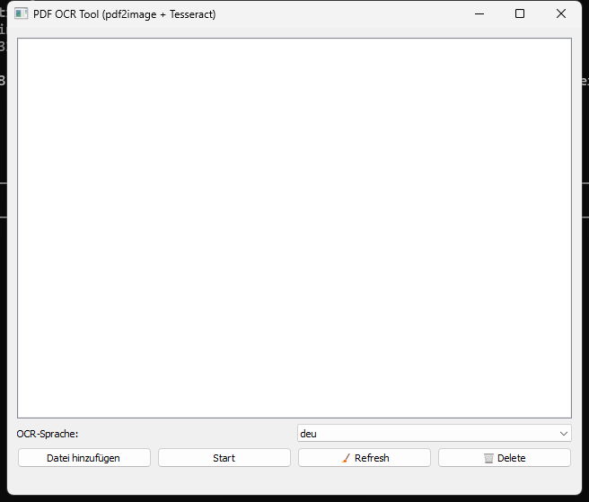
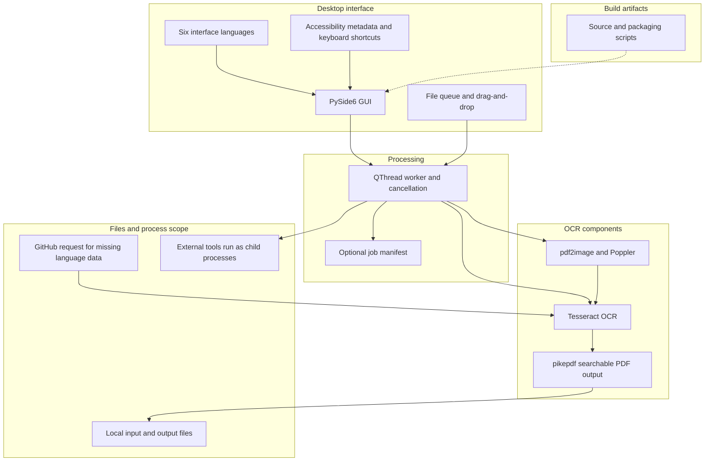

# Guía detallada archivada — edición con afirmaciones corregidas

> Predecesora de [README_es.md](README_es.md). Basada en el commit fuente 3cfce468f20307bcbc158dd969c3ad304f34b4fe (2026-10-12); esta edición corrige afirmaciones actuales y no es una copia sin cambios. El original está disponible en [README_es.md de ese commit](https://github.com/doc-bricks/PDFtoPDFocr/blob/3cfce468f20307bcbc158dd969c3ad304f34b4fe/README_es.md).

---


[English](README.md) | [Deutsch](README_de.md) | [Español](README_es.md) | [中文](README_zh.md) | [日本語](README_ja.md) | [Русский](README_ru.md)

*Traducción asistida por máquina; el README en inglés es la versión de referencia.*

# PDFtoPDFocr - Conversor OCR de PDF con enfoque local

[](https://www.python.org/)
[](pyproject.toml)
[](LICENSE)
[](https://www.qt.io/)
[](#requirements--platform-matrix)
[](#core-features)
[](NOTICE)
[](llms.txt)
[](https://github.com/doc-bricks)
[](https://github.com/open-bricks)

Convierte archivos PDF escaneados e imágenes en bruto en PDF con texto buscable mediante OCR local (reconocimiento óptico de caracteres) con Tesseract. Ofrece procesamiento por lotes multiformato, idioma de OCR seleccionable con descarga automática de paquetes de idioma, conservación no destructiva de los archivos originales, una interfaz con ergonomía accesible e integración portable de Tesseract/Poppler.

Contexto del proyecto legible por máquina: [`llms.txt`](llms.txt) | [Documentación en alemán](README_de.md) | [Política de seguridad](SECURITY.md)

> [!NOTE]
> **Integración con IA y LLM:** Este repositorio contiene un archivo [`llms.txt`](llms.txt) estructurado que proporciona contexto legible por máquina, detalles de arquitectura, interfaces CLI/GUI y puntos de entrada de pruebas para agentes autónomos y herramientas de desarrollo.

> [!TIP]
> OCR y ensamblaje de PDF usan herramientas locales. Si faltan datos Tesseract para el idioma elegido, la aplicación puede solicitarlos a GitHub; no bloquea el acceso de red del sistema.

---

## 🧭 Navegación rápida

1. 📸 [Galería visual y resumen de la interfaz](#visual-showcase)
2. 🏛️ [Arquitectura del sistema y topología de 5 capas](#system-architecture--component-workflow)
3. 🔄 [Flujo de datos local y ciclo de vida del procesamiento OCR de documentos](#local-data-flow--privacy-isolation)
4. 🚀 [Inicio rápido y operaciones clave](#quick-start--key-operations)
5. ✨ [Funciones principales y capacidades de rendimiento](#core-features)
6. 🎯 [Uso previsto](#target-personas--discoverability)
7. ⚖️ [Nota sobre comparaciones](#comparative-matrix--alternatives)
8. ⌨️ [Accesibilidad y atajos de teclado](#accessibility--keyboard-shortcuts)
9. 💻 [Requisitos y matriz de plataformas](#requirements--platform-matrix)
10. 📦 [Instalación y configuración portable](#installation--portable-setup)
11. 🖥️ [Uso y pautas de ejecución](#usage--execution-guidelines)
12. 🧪 [Pruebas automatizadas y verificación de calidad](#tests--quality-verification)
13. 🌐 [Herramientas hermanas e integración en el ecosistema](#sibling-tools--ecosystem)
14. 📜 [Información seleccionada sobre licencias de terceros](#third-party-licenses--transparency)
15. 🔒 [Alcance de privacidad y seguridad](#privacy--security-model)
16. 🪟 [Empaquetado EXE y distribución (MSIX de Windows Store y portable)](#exe--distribution-packaging)
17. 🤖 [Contexto LLM legible por máquina (llms.txt)](#machine-readable-llm-context)
18. ⚖️ [Aviso legal (§ 521 BGB) y licencia](#statutory-notice--license)

---

<a id="visual-showcase"></a>
<a id="visuelle-showcase-galerie"></a>
## 📸 Galería visual y resumen de la interfaz

| Interfaz principal | Recursos visuales e identidad de la aplicación |
|:---:|:---:|
| <br/><sub>**Cola de conversión por lotes** — Incorporación de archivos por arrastrar y soltar, selección dinámica de idioma, insignias de estado por elemento en tiempo real y progreso del trabajador sin bloqueo.</sub> | <br/><sub>**Identidad de la aplicación en alta resolución** — Conjunto de iconos nativos para Windows Store, paquete MSIX y paletas de contraste accesibles.</sub> |

---

<a id="system-architecture--component-workflow"></a>
<a id="systemarchitektur--komponenten-workflow"></a>
<a id="four-view-architectural-topology-projection"></a>
<a id="vier-sichten-architektur-topologie-projektion"></a>
## 🏛️ Arquitectura y flujo de componentes



### Resumen de cuatro vistas

- Interfaz: GUI PySide6, cola de archivos, seis idiomas, metadatos de accesibilidad y atajos.
- Trabajo: hilo QThread, cancelación y exportación opcional de un manifiesto de trabajo.
- OCR: pdf2image/Poppler, normalización de imágenes, Tesseract y salida PDF con pikepdf.
- Ejecución: los procesos externos heredan los privilegios del proceso que los inicia; la aplicación no crea una sandbox ni bloquea la red.

The diagram shows component flow; it does not describe a network filter, sandbox, or license boundary.

<a id="local-data-flow--privacy-isolation"></a>
<a id="lokaler-datenfluss--datenschutz-isolation"></a>
## 🔄 Flujo de datos local y ciclo de vida del procesamiento OCR de documentos

```mermaid
sequenceDiagram
    autonumber
    actor User as Usuario / Operador de lotes
    participant GUI as GUI de escritorio PySide6
    participant Worker as Hilo de trabajo en segundo plano
    participant Normalizer as Normalizador de imágenes
    participant Poppler as Poppler / pdf2image
    participant Tesseract as Motor OCR Tesseract
    participant Assembler as Ensamblador de PDF pikepdf
    participant FS as Local Filesystem

    User->>GUI: Añadir archivos PDF o de imagen (arrastrar y soltar / diálogo de archivos)
    User->>GUI: Seleccionar el idioma de OCR de destino (p. ej. deu, eng, fra, spa)
    User->>GUI: Iniciar la conversión por lotes (Ctrl+Return o botón)
    GUI->>Worker: Lanzar tarea de conversión asíncrona
    loop Para cada documento de la cola
        alt La entrada es un PDF escaneado
            Worker->>Poppler: Rasterizar las páginas del PDF en mapas de bits en memoria
            Poppler-->>Worker: Búferes de página renderizados en alta resolución
        else La entrada es una imagen directa (PNG, JPG, TIFF multicuadro)
            Worker->>Normalizer: Componer la transparencia alfa sobre fondo blanco
            Normalizer-->>Worker: Fotogramas RGB estandarizados
        end
        loop Para cada página / fotograma
            Worker->>Tesseract: Extraer texto y cuadros delimitadores mediante el motor local
            Tesseract-->>Worker: Devolver texto OCR y capas hOCR / PDF
        end
        Worker->>Assembler: Inyectar la capa de texto completo buscable en la estructura del PDF
        Assembler->>FS: Guardar la salida como <filename>_ocred.pdf (no destructivo)
        Worker-->>GUI: Actualizar la barra de progreso y la insignia de estado codificada por colores
    end
    opt Exportación del manifiesto de trabajo portable
        GUI->>FS: Escribir pdftopdfocr-job-v1.json (ajustes del trabajo y metadatos de archivos)
    end
    Note over User,FS: Procesamiento local de OCR/PDF; la descarga de datos de idioma que falten puede usar GitHub.
```

---

<a id="quick-start--key-operations"></a>
<a id="schnelleinstieg--kernabläufe"></a>
## 🚀 Inicio rápido y operaciones clave

| Tarea | Interfaz / Comando | Salida / Resultado |
|---|---|---|
| **Iniciar la aplicación de escritorio** | `python PDFtoPDFocr_2.py` o `START.bat` | GUI de escritorio PySide6 con cola de archivos por arrastrar y soltar |
| **Convertir PDF escaneados** | Añada archivos, seleccione el idioma, haga clic en "Start" (`Ctrl+Return`) | `*_ocred.pdf` no destructivo con capa de búsqueda de texto completo |
| **OCR directo de imágenes** | Suelte imágenes JPG, PNG o TIFF multicuadro | Documento PDF buscable ensamblado |
| **Combinar en un único PDF** | Active "Auto-Merge" en la barra de herramientas | PDF buscable consolidado de varios documentos |
| **Exportar el manifiesto de trabajo** | Haga clic en "Job-Export" (`Ctrl+E`) | Manifiesto portable `pdftopdfocr-job-v1.json` |
| **Ejecutar pruebas** | <code>python -m pytest</code> | Ejecuta la suite de pruebas del repositorio |
| **Compilación portable** | `python build_release.py --clean` | Ejecutable autónomo en `dist/PDFtoPDFocr/` |

---

<a id="core-features"></a>
<a id="funktionen--features"></a>
## ✨ Funciones principales y capacidades de rendimiento

- **Procesamiento por lotes** — Convierta varios PDF e imágenes simultáneamente mediante el selector de archivos o arrastrando y soltando.
- **Importación directa de imágenes** — Convierta escaneos JPG, PNG y TIFF multicuadro directamente en PDF buscables, sin herramientas adicionales.
- **Idioma de OCR seleccionable** — Selección rápida de alemán, inglés, francés, español y decenas de otros idiomas.
- **Descarga automática** — Los paquetes de idioma de Tesseract que faltan (`.traineddata`) se descargan automáticamente bajo demanda desde los repositorios oficiales de GitHub.
- **Combinación y apilado automáticos** — Combine varios resultados de OCR procesados en un único documento PDF consolidado.
- **Tesseract y Poppler portables** — Las compilaciones portables (`python build_release.py`) incluyen Tesseract y Poppler; al ejecutar desde el código fuente, Tesseract y Poppler deben estar instalados o colocados en `tesseract_portable/` y `poppler/` junto a la aplicación.
- **Archivo original conservado** — Los resultados se guardan con el sufijo `_ocred.pdf` o en una carpeta de salida configurada; los archivos de origen permanecen intactos.
- **Exportación del manifiesto de trabajo** — Guarde manifiestos portables `pdftopdfocr-job-v1.json` con los ajustes del trabajo, el estado de ejecución y los metadatos de los archivos.
- **Accesibilidad (A11y) y ergonomía completas** — Nombres y descripciones accesibles para lectores de pantalla en todos los controles, descripciones emergentes informativas en el idioma activo y atajos de teclado completos (`Ctrl+O`, `Ctrl+Return`, `Ctrl+E`, `F5`, `Ctrl+Shift+O`, `Del`/`Backspace`).
- **Estado visual** — Colores de estado y descripciones emergentes muestran el progreso de cada elemento.

---

<a id="target-personas--discoverability"></a>
<a id="zielgruppen--auffindbarkeit"></a>
## 🎯 Uso previsto

PDFtoPDFocr convierte archivos PDF escaneados e imágenes en PDF con texto buscable mediante OCR local. Los datos Tesseract que falten pueden solicitarse a GitHub. El proyecto no certifica cumplimiento legal, sanitario ni normativo.

<a id="comparative-matrix--alternatives"></a>
<a id="vergleichsmatrix--alternativen"></a>
## ⚖️ Nota sobre comparaciones

La matriz comparativa histórica se retira porque no contaba con pruebas actuales verificadas de forma independiente para cada alternativa. No debe leerse como una comparación vigente.

<a id="accessibility--keyboard-shortcuts"></a>
<a id="barrierefreiheit--tastenkürzel"></a>
## ⌨️ Accesibilidad y atajos de teclado

| Acción | Atajo | Descripción |
|---|---|---|
| **Añadir archivos** | `Ctrl+O` | Abrir el diálogo de selección de archivos |
| **Iniciar OCR** | `Ctrl+Return` | Iniciar el procesamiento OCR por lotes |
| **Exportar el manifiesto de trabajo** | `Ctrl+E` | Exportar el estado del trabajo como manifiesto JSON |
| **Vaciar la lista y restablecer** | `F5` | Restablecer la lista de archivos y la visualización del estado |
| **Seleccionar la carpeta de salida** | `Ctrl+Shift+O` | Elegir un directorio de salida personalizado |
| **Quitar el archivo seleccionado** | `Del` o `Backspace` | Quitar el elemento seleccionado de la cola |

---

<a id="requirements--platform-matrix"></a>
<a id="voraussetzungen--plattformmatrix"></a>
## 💻 Requisitos y matriz de plataformas

- Python 3.10+
- Windows 10/11 (objetivo principal de la versión)
- macOS / Linux (objetivos de código fuente y pruebas de humo)

---

<a id="installation--portable-setup"></a>
<a id="installation--portables-setup"></a>
## 📦 Instalación y configuración portable

```bash
pip install -r requirements.txt
```

Tesseract OCR y Poppler deben estar disponibles al ejecutar desde el código fuente: en el `PATH` (Tesseract también puede configurarse mediante `TESSERACT_CMD`) o de forma portable dentro del directorio del proyecto (`tesseract_portable/`, `poppler/`). Los paquetes de idioma que faltan se descargan automáticamente.

---

<a id="usage--execution-guidelines"></a>
<a id="nutzung--ausführungsrichtlinien"></a>
## 🖥️ Uso y pautas de ejecución

```bash
python PDFtoPDFocr_2.py
```

En Windows, `START.bat` también sirve como lanzador de escritorio con doble clic.

1. Añada PDF o imágenes mediante el selector de archivos o arrastrando y soltando.
2. Seleccione el idioma de OCR (los paquetes de idioma que faltan se descargan automáticamente).
3. Haga clic en "Start" — listo.
4. Opcionalmente, use `Job-Export` para guardar un manifiesto portable `pdftopdfocr-job-v1.json`.

---

<a id="tests--quality-verification"></a>
<a id="tests--qualitätsprüfung"></a>
## 🧪 Pruebas automatizadas y verificación de calidad

```bash
python -m pip install -r requirements-dev.txt
python -m pytest
```

La suite de pruebas cubre:
- **Accesibilidad de la interfaz y atajos** (`tests/test_ui_accessibility.py`)
- **Configuración de Tesseract** (`tests/test_tesseract_config.py`)
- **Formato de exportación de trabajos y esquema del manifiesto** (`tests/test_export_format.py`)
- **Cambio de idioma y compatibilidad multilingüe** (`tests/test_language_switch.py`)
- **Regresiones de errores y ciclo de vida de recursos** (`tests/test_bug_regressions.py`)
- **Iconos de la aplicación y verificación de recursos visuales** (`tests/test_app_assets.py`)
- **Empaquetado de plataformas y validación de versiones** (`tests/test_build_release.py`, `tests/test_platform_package_gate.py`)
- **Metadatos, seguridad y gobernanza de paridad** (`tests/test_metadata.py`, `tests/test_security_license_contract.py`)

---

<a id="sibling-tools--ecosystem"></a>
<a id="geschwister-tools--ökosystem"></a>
## 🌐 Herramientas hermanas e integración en el ecosistema

PDFtoPDFocr forma parte de la familia de utilidades documentales **doc-bricks** y del ecosistema más amplio de escritorio de código abierto **open-bricks**:

| Herramienta | Ecosistema | Propósito | Repositorio |
|---|---|---|---|
| **DokuReader** | `doc-bricks` | Biblioteca local de documentos, espacio de lectura y visor multiformato | [doc-bricks/DokuReader](https://github.com/doc-bricks/DokuReader) |
| **MediaBrain** | `doc-bricks` | Inspector local de metadatos multimedia, analizador EXIF y clasificador por lotes | [doc-bricks/MediaBrain](https://github.com/doc-bricks/MediaBrain) |
| **UniversalDocsGrabber** | `doc-bricks` | Extractor automatizado de documentos de correo electrónico y canalización de ingesta OCR por lotes | [doc-bricks/UniversalDocsGrabber](https://github.com/doc-bricks/UniversalDocsGrabber) |
| **UniversalInvoiceMail** | `doc-bricks` | Extracción de facturas y exportación CSV de estilo DATEV | [doc-bricks/UniversalInvoiceMail](https://github.com/doc-bricks/UniversalInvoiceMail) |
| **UniversalMailCleaner** | `doc-bricks` | Limpiador de buzones centrado en la privacidad, baja de boletines y depurador seguro | [doc-bricks/UniversalMailCleaner](https://github.com/doc-bricks/UniversalMailCleaner) |
| **CleanMarkdown** | `doc-bricks` | Saneamiento de Markdown, formato de tablas y linter de documentación | [doc-bricks/CleanMarkdown](https://github.com/doc-bricks/CleanMarkdown) |
| **LitZentrum** | `doc-bricks` | Gestor de literatura académica, enlazador de citas BibTeX y espacio de investigación | [doc-bricks/LitZentrum](https://github.com/doc-bricks/LitZentrum) |
| **MailProcessor** | `doc-bricks` | Motor local basado en reglas de archivo de correo, filtrado de adjuntos y ordenación | [doc-bricks/MailProcessor](https://github.com/doc-bricks/MailProcessor) |
| **ProFiler** | `file-bricks` | Búsqueda rápida de archivos por múltiples criterios, filtrado con regex y renombrado por lotes | [file-bricks/ProFiler](https://github.com/file-bricks/ProFiler) |
| **ExplorerPro** | `file-bricks` | Gestor de archivos de escritorio de doble panel con pestañas, marcadores y vista previa hexadecimal | [file-bricks/ExplorerPro](https://github.com/file-bricks/ExplorerPro) |
| **DevCenter** | `dev-bricks` | Gestor del entorno de desarrollo, orquestador de cadenas de herramientas y lanzador de proyectos | [dev-bricks/DevCenter](https://github.com/dev-bricks/DevCenter) |
| **CodeBox** | `dev-bricks` | Área de pruebas de código multilenguaje sin conexión, organizador de fragmentos y sandbox | [dev-bricks/CodeBox](https://github.com/dev-bricks/CodeBox) |
| **open-bricks** | `open-bricks` | Organización paraguas y catálogo curado de herramientas de escritorio centradas en la privacidad | [open-bricks](https://github.com/open-bricks) |

---

<a id="third-party-licenses--transparency"></a>
<a id="drittanbieter-lizenzen--transparenz"></a>
## 📜 Información seleccionada sobre licencias de terceros

Este repositorio ofrece un inventario seleccionado de información sobre licencias de dependencias y herramientas incluidas. No es una lista completa de materiales de software ni una certificación de cumplimiento. Las obligaciones dependen de los componentes y artefactos de distribución concretos; ejecutar una herramienta como subproceso no constituye por sí solo una frontera legal o de seguridad. La licencia del proyecto es MIT; las licencias de terceros son independientes. Consulta [THIRD_PARTY_LICENSES.md](THIRD_PARTY_LICENSES.md) y [THIRD_PARTY_LICENSES.txt](THIRD_PARTY_LICENSES.txt) para el inventario disponible.

<a id="privacy--security-model"></a>
<a id="datenschutz--sicherheitsmodell"></a>
## 🔒 Alcance de privacidad y seguridad

El OCR y el ensamblaje de PDF usan herramientas locales. El código de la aplicación puede solicitar a GitHub los datos Tesseract que falten. Esto no impone una restricción de red al sistema. Los procesos iniciados heredan los privilegios del proceso que los inicia; la aplicación no los aísla en una sandbox. Consulta SECURITY.md para la política de mantenimiento y el canal de reporte.

<a id="exe--distribution-packaging"></a>
<a id="exe--distributions-packaging"></a>
## 🪟 Empaquetado EXE y distribución (MSIX de Windows Store y portable)

```bash
python build_release.py --clean

# or on Windows via double-click / terminal:
build_exe.bat

# or directly via PyInstaller with dependencies installed:
python -m PyInstaller --noconfirm --clean PDFtoPDFocr.spec
```

La compilación empaquetada se escribe en `dist/PDFtoPDFocr/`. Si existen, `tesseract_portable/` y `poppler/` se incluyen automáticamente.

---

<a id="machine-readable-llm-context"></a>
<a id="maschinenlesbarer-llm-kontext"></a>
## 🤖 Contexto LLM legible por máquina (llms.txt)

Para agentes de programación autónomos con IA, programadores en pareja y canalizaciones de CI automatizadas, este repositorio ofrece un índice [`llms.txt`](llms.txt) dedicado que sigue las convenciones modernas de contexto para LLM. Incluye:
- Resumen de la arquitectura y funciones de los componentes
- Comandos de la suite de pruebas y puertas de verificación
- Política de mantenimiento y alcance de las pruebas descritos en SECURITY.md
- Mapa de archivos clave y matrices de dependencias

---

<a id="statutory-notice--license"></a>
<a id="contributing--license"></a>
<a id="gesetzlicher-hinweis--lizenz"></a>
<a id="mitwirken--lizenz"></a>
## ⚖️ Licencia y nota legal

El proyecto se distribuye bajo la licencia [MIT](LICENSE). La posible aplicación de normas legales como el § 521 BGB depende de la relación jurídica y de la legislación aplicable; esta documentación no establece una exención general de responsabilidad.
