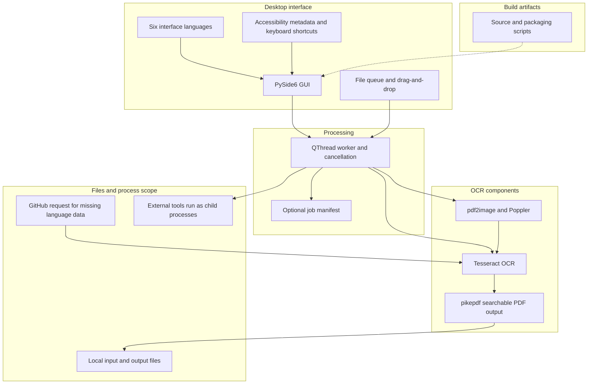
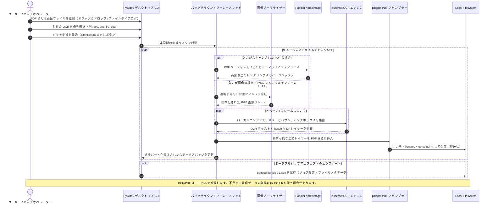

# 詳細ガイドのアーカイブ — 記述修正版

> [README_ja.md](README_ja.md) の前版です。ソースコミット 3cfce468f20307bcbc158dd969c3ad304f34b4fe（2026-10-12）を基に、現在の主張を訂正した版で、無変更の複製ではありません。元の内容は [同コミットのREADME_ja.md](https://github.com/doc-bricks/PDFtoPDFocr/blob/3cfce468f20307bcbc158dd969c3ad304f34b4fe/README_ja.md) で確認できます。

---


[English](README.md) | [Deutsch](README_de.md) | [Español](README_es.md) | [中文](README_zh.md) | [日本語](README_ja.md) | [Русский](README_ru.md)

*機械支援による翻訳です。正式な内容は英語版 README が優先されます。*

# PDFtoPDFocr - ローカルファーストの PDF OCR 変換ツール

[](https://www.python.org/)
[](pyproject.toml)
[](LICENSE)
[](https://www.qt.io/)
[](#requirements--platform-matrix)
[](#core-features)
[](NOTICE)
[](llms.txt)
[](https://github.com/doc-bricks)
[](https://github.com/open-bricks)

Tesseract によるローカル OCR（光学文字認識）を用いて、スキャンされた PDF ファイルや画像ファイルを検索可能な PDF に変換します。複数形式のバッチ処理、言語パックの自動ダウンロードに対応した OCR 言語の選択、元ファイルを破壊しない保存、アクセシブルな UI の操作性、そしてポータブルな Tesseract/Poppler の統合を備えています。

機械可読なプロジェクトコンテキスト: [`llms.txt`](llms.txt) | [ドイツ語ドキュメント](README_de.md) | [セキュリティポリシー](SECURITY.md)

> [!NOTE]
> **AI・LLM 連携:** このリポジトリには構造化された [`llms.txt`](llms.txt) ファイルが含まれており、自律型エージェントや開発者向けツールのために、機械可読なコンテキスト、アーキテクチャの詳細、CLI/GUI インターフェース、テストのエントリポイントを提供します。

> [!TIP]
> OCR と PDF の組み立てにはローカルツールを使います。選択した言語の Tesseract データがない場合、GitHub から取得することがあります。システム全体のネットワークアクセスを遮断する機能ではありません。

---

## 🧭 クイックナビゲーション

1. 📸 [ビジュアルショーケースとインターフェース概要](#visual-showcase)
2. 🏛️ [システムアーキテクチャと 5 層トポロジー](#system-architecture--component-workflow)
3. 🔄 [ローカルデータフローとドキュメント OCR 処理ライフサイクル](#local-data-flow--privacy-isolation)
4. 🚀 [クイックスタートと主な操作](#quick-start--key-operations)
5. ✨ [主な機能とパフォーマンス性能](#core-features)
6. 🎯 [想定用途](#target-personas--discoverability)
7. ⚖️ [比較に関する注記](#comparative-matrix--alternatives)
8. ⌨️ [アクセシビリティ機能とキーボード操作](#accessibility--keyboard-shortcuts)
9. 💻 [要件とプラットフォームマトリクス](#requirements--platform-matrix)
10. 📦 [インストールとポータブルセットアップ](#installation--portable-setup)
11. 🖥️ [使い方と実行ガイドライン](#usage--execution-guidelines)
12. 🧪 [自動テストと品質検証](#tests--quality-verification)
13. 🌐 [姉妹ツールとエコシステム統合](#sibling-tools--ecosystem)
14. 📜 [サードパーティライセンス情報（抜粋）](#third-party-licenses--transparency)
15. 🔒 [プライバシーとセキュリティの対象範囲](#privacy--security-model)
16. 🪟 [EXE と配布パッケージング（Windows Store MSIX とポータブル）](#exe--distribution-packaging)
17. 🤖 [機械可読な LLM コンテキスト（llms.txt）](#machine-readable-llm-context)
18. ⚖️ [法的通知（§ 521 BGB）とライセンス](#statutory-notice--license)

---

<a id="visual-showcase"></a>
<a id="visuelle-showcase-galerie"></a>
## 📸 ビジュアルショーケースとインターフェース概要

| メインインターフェース | ビジュアルアセットとアプリのアイデンティティ |
|:---:|:---:|
| <br/><sub>**バッチ変換キュー** — ドラッグ＆ドロップによるファイル取り込み、動的な言語選択、リアルタイムの項目ステータスバッジ、ノンブロッキングのワーカー進捗表示。</sub> | <br/><sub>**高解像度のアプリアイデンティティ** — ネイティブ Windows Store 用の MSIX パッケージアイコンセットと、アクセシブルなコントラストパレット。</sub> |

---

<a id="system-architecture--component-workflow"></a>
<a id="systemarchitektur--komponenten-workflow"></a>
<a id="four-view-architectural-topology-projection"></a>
<a id="vier-sichten-architektur-topologie-projektion"></a>
## 🏛️ アーキテクチャとコンポーネントの流れ



### 4 つの視点で見る構成

- 画面: PySide6 GUI、ファイルキュー、6 言語、アクセシビリティ用メタデータ、キーボード操作。
- 処理: QThread ワーカー、キャンセル、任意のジョブマニフェスト出力。
- OCR: pdf2image/Poppler、画像正規化、Tesseract、pikepdf による PDF 出力。
- 実行: 子プロセスは起動元プロセスの権限を引き継ぎます。アプリはサンドボックスを作らず、ネットワークも遮断しません。

The diagram shows component flow; it does not describe a network filter, sandbox, or license boundary.

<a id="local-data-flow--privacy-isolation"></a>
<a id="lokaler-datenfluss--datenschutz-isolation"></a>
## 🔄 ローカルデータフローとドキュメント OCR 処理ライフサイクル



---

<a id="quick-start--key-operations"></a>
<a id="schnelleinstieg--kernabläufe"></a>
## 🚀 クイックスタートと主な操作

| タスク | インターフェース / コマンド | 出力 / 結果 |
|---|---|---|
| **デスクトップアプリの起動** | `python PDFtoPDFocr_2.py` または `START.bat` | ドラッグ＆ドロップ対応のファイルキューを備えた PySide6 デスクトップ GUI |
| **スキャン PDF の変換** | ファイルを追加し、言語を選択して「Start」をクリック（`Ctrl+Return`） | 全文検索レイヤー付きの非破壊 `*_ocred.pdf` |
| **画像の直接 OCR** | JPG、PNG、またはマルチフレーム TIFF 画像をドロップ | 組み立てられた検索可能な PDF ドキュメント |
| **単一 PDF への結合** | ツールバーで「Auto-Merge」を有効にする | 統合された複数ドキュメントの検索可能 PDF |
| **ジョブマニフェストのエクスポート** | 「Job-Export」をクリック（`Ctrl+E`） | ポータブルな `pdftopdfocr-job-v1.json` マニフェスト |
| **テスト実行** | <code>python -m pytest</code> | リポジトリのテストスイートを実行 |
| **ポータブルビルド** | `python build_release.py --clean` | `dist/PDFtoPDFocr/` 内の自己完結型実行ファイル |

---

<a id="core-features"></a>
<a id="funktionen--features"></a>
## ✨ 主な機能とパフォーマンス性能

- **バッチ処理** — ファイルピッカーまたはドラッグ＆ドロップで、複数の PDF と画像を同時に変換します。
- **画像の直接インポート** — JPG、PNG、マルチフレーム TIFF のスキャンを、追加ツールなしで検索可能な PDF に直接変換します。
- **選択可能な OCR 言語** — ドイツ語、英語、フランス語、スペイン語をはじめ、数十の言語をすばやく選択できます。
- **自動ダウンロード** — 不足している Tesseract 言語パック（`.traineddata`）は、公式 GitHub リポジトリから必要に応じて自動的にダウンロードされます。
- **自動結合とスタッキング** — 処理された複数の OCR 結果を、1 つの統合された PDF ドキュメントにまとめます。
- **ポータブルな Tesseract と Poppler** — ポータブルビルド（`python build_release.py`）には Tesseract と Poppler が同梱されます。ソースから実行する場合は、Tesseract と Poppler をインストールするか、アプリの隣にある `tesseract_portable/` と `poppler/` に配置する必要があります。
- **元ファイルの保持** — 結果は `_ocred.pdf` サフィックス付き、または設定した出力フォルダに保存され、元ファイルには一切手が加えられません。
- **ジョブマニフェストのエクスポート** — ジョブ設定、実行ステータス、ファイルメタデータを含むポータブルな `pdftopdfocr-job-v1.json` マニフェストを保存します。
- **アクセシビリティと操作性** — コントロール名・説明、ツールチップ、キーボードショートカットを備えます。独立した WCAG 監査を主張するものではありません。
- **状態表示** — 項目ごとの色とツールチップで処理状況を表示します。

---

<a id="target-personas--discoverability"></a>
<a id="zielgruppen--auffindbarkeit"></a>
## 🎯 想定用途

PDFtoPDFocr はスキャン PDF と画像を、ローカル OCR で検索可能な PDF に変換します。不足する Tesseract 言語データは GitHub から取得される場合があります。本プロジェクトは法務・医療・規制への適合を認証するものではありません。

<a id="comparative-matrix--alternatives"></a>
<a id="vergleichsmatrix--alternativen"></a>
## ⚖️ 比較に関する注記

以前の比較表は、各製品について最新の独立検証済み根拠がなかったため撤回しました。現在の製品比較として利用しないでください。

<a id="accessibility--keyboard-shortcuts"></a>
<a id="barrierefreiheit--tastenkürzel"></a>
## ⌨️ アクセシビリティ機能とキーボード操作

| 操作 | ショートカット | 説明 |
|---|---|---|
| **ファイルを追加** | `Ctrl+O` | ファイル選択ダイアログを開く |
| **OCR を開始** | `Ctrl+Return` | バッチ OCR 処理を開始する |
| **ジョブマニフェストをエクスポート** | `Ctrl+E` | ジョブの状態を JSON マニフェストとしてエクスポートする |
| **リストをクリアしてリセット** | `F5` | ファイルリストとステータス表示をリセットする |
| **出力フォルダを選択** | `Ctrl+Shift+O` | カスタムの出力ディレクトリを選択する |
| **選択したファイルを削除** | `Del` または `Backspace` | 選択した項目をキューから削除する |

---

<a id="requirements--platform-matrix"></a>
<a id="voraussetzungen--plattformmatrix"></a>
## 💻 要件とプラットフォームマトリクス

- Python 3.10+
- Windows 10/11（主要なリリース対象）
- macOS / Linux（ソースおよびスモークテストの対象）

---

<a id="installation--portable-setup"></a>
<a id="installation--portables-setup"></a>
## 📦 インストールとポータブルセットアップ

```bash
pip install -r requirements.txt
```

ソースから実行する場合は、Tesseract OCR と Poppler が利用可能である必要があります。`PATH` 上に置く（Tesseract は `TESSERACT_CMD` でも指定可能）か、プロジェクトディレクトリ内にポータブルとして配置します（`tesseract_portable/`、`poppler/`）。不足している言語パックは自動的にダウンロードされます。

---

<a id="usage--execution-guidelines"></a>
<a id="nutzung--ausführungsrichtlinien"></a>
## 🖥️ 使い方と実行ガイドライン

```bash
python PDFtoPDFocr_2.py
```

Windows では、`START.bat` をダブルクリック用のデスクトップランチャーとしても使用できます。

1. ファイルピッカーまたはドラッグ＆ドロップで PDF や画像を追加します。
2. OCR 言語を選択します（不足している言語パックは自動的にダウンロードされます）。
3. 「Start」をクリックします — 完了です。
4. 必要に応じて `Job-Export` を使用し、ポータブルな `pdftopdfocr-job-v1.json` マニフェストを保存します。

---

<a id="tests--quality-verification"></a>
<a id="tests--qualitätsprüfung"></a>
## 🧪 自動テストと品質検証

```bash
python -m pip install -r requirements-dev.txt
python -m pytest
```

テストスイートがカバーする範囲:
- **UI アクセシビリティとショートカット**（`tests/test_ui_accessibility.py`）
- **Tesseract 設定**（`tests/test_tesseract_config.py`）
- **ジョブエクスポート形式とマニフェストスキーマ**（`tests/test_export_format.py`）
- **言語切り替えと多言語サポート**（`tests/test_language_switch.py`）
- **バグ回帰とリソースライフサイクル**（`tests/test_bug_regressions.py`）
- **アプリアイコンとビジュアルアセットの検証**（`tests/test_app_assets.py`）
- **プラットフォームパッケージングとリリース検証**（`tests/test_build_release.py`、`tests/test_platform_package_gate.py`）
- **メタデータ、セキュリティ、パリティガバナンス**（`tests/test_metadata.py`、`tests/test_security_license_contract.py`）

---

<a id="sibling-tools--ecosystem"></a>
<a id="geschwister-tools--ökosystem"></a>
## 🌐 姉妹ツールとエコシステム統合

PDFtoPDFocr は、**doc-bricks** ドキュメントユーティリティファミリーの一員であり、より広範な **open-bricks** オープンソースデスクトップエコシステムの一部です:

| ツール | エコシステム | 目的 | リポジトリ |
|---|---|---|---|
| **DokuReader** | `doc-bricks` | ローカルドキュメントライブラリ、閲覧ワークスペース、クロスフォーマットビューア | [doc-bricks/DokuReader](https://github.com/doc-bricks/DokuReader) |
| **MediaBrain** | `doc-bricks` | ローカルメディアのメタデータインスペクター、EXIF アナライザー、バッチ分類器 | [doc-bricks/MediaBrain](https://github.com/doc-bricks/MediaBrain) |
| **UniversalDocsGrabber** | `doc-bricks` | 自動化されたメール文書抽出器と OCR バッチ取り込みパイプライン | [doc-bricks/UniversalDocsGrabber](https://github.com/doc-bricks/UniversalDocsGrabber) |
| **UniversalInvoiceMail** | `doc-bricks` | 請求書の抽出と DATEV 形式を参考にした CSV エクスポート | [doc-bricks/UniversalInvoiceMail](https://github.com/doc-bricks/UniversalInvoiceMail) |
| **UniversalMailCleaner** | `doc-bricks` | プライバシーファーストのメールボックスクリーナー、ニュースレター配信停止ツール、安全なプルーナー | [doc-bricks/UniversalMailCleaner](https://github.com/doc-bricks/UniversalMailCleaner) |
| **CleanMarkdown** | `doc-bricks` | Markdown のサニタイズ、テーブル整形、ドキュメントリンター | [doc-bricks/CleanMarkdown](https://github.com/doc-bricks/CleanMarkdown) |
| **LitZentrum** | `doc-bricks` | 学術文献マネージャー、BibTeX 引用バインダー、研究ワークスペース | [doc-bricks/LitZentrum](https://github.com/doc-bricks/LitZentrum) |
| **MailProcessor** | `doc-bricks` | ルールベースのローカルメールアーカイブ、添付ファイルのフィルタリング・仕分けエンジン | [doc-bricks/MailProcessor](https://github.com/doc-bricks/MailProcessor) |
| **ProFiler** | `file-bricks` | 高速なマルチ条件ファイル検索、正規表現フィルタリング、一括リネーム | [file-bricks/ProFiler](https://github.com/file-bricks/ProFiler) |
| **ExplorerPro** | `file-bricks` | タブ、ブックマーク、16 進プレビューを備えたデュアルペインのデスクトップファイルマネージャー | [file-bricks/ExplorerPro](https://github.com/file-bricks/ExplorerPro) |
| **DevCenter** | `dev-bricks` | 開発環境マネージャー、ツールチェーンオーケストレーター、プロジェクトランチャー | [dev-bricks/DevCenter](https://github.com/dev-bricks/DevCenter) |
| **CodeBox** | `dev-bricks` | オフラインの多言語コードプレイグラウンド、スニペット整理ツール、サンドボックス | [dev-bricks/CodeBox](https://github.com/dev-bricks/CodeBox) |
| **open-bricks** | `open-bricks` | プライバシーファーストのデスクトップツールを集めた、統括組織兼キュレーションカタログ | [open-bricks](https://github.com/open-bricks) |

---

<a id="third-party-licenses--transparency"></a>
<a id="drittanbieter-lizenzen--transparenz"></a>
## 📜 サードパーティライセンス情報（抜粋）

このリポジトリには、依存関係と同梱ツールのライセンス情報を選択して記載しています。完全なソフトウェア部品表や配布コンプライアンス認証ではありません。義務は実際に使うコンポーネントと配布物によって異なります。ツールを子プロセスとして実行することだけで法的・セキュリティ上の境界が成立するわけではありません。プロジェクトのライセンスは MIT で、サードパーティのライセンスは別個です。利用可能な一覧は [THIRD_PARTY_LICENSES.md](THIRD_PARTY_LICENSES.md) と [THIRD_PARTY_LICENSES.txt](THIRD_PARTY_LICENSES.txt) を参照してください。

<a id="privacy--security-model"></a>
<a id="datenschutz--sicherheitsmodell"></a>
## 🔒 プライバシーとセキュリティの対象範囲

OCR と PDF の組み立てにはローカルツールを使います。アプリのコードは不足する Tesseract 言語データを GitHub から取得する場合があります。システム全体のネットワークを制限する機能ではありません。起動したプロセスは起動元の権限を引き継ぎ、アプリはサンドボックスに隔離しません。保守ポリシーと報告窓口は SECURITY.md を参照してください。

<a id="exe--distribution-packaging"></a>
<a id="exe--distributions-packaging"></a>
## 🪟 EXE と配布パッケージング（Windows Store MSIX とポータブル）

```bash
python build_release.py --clean

# or on Windows via double-click / terminal:
build_exe.bat

# or directly via PyInstaller with dependencies installed:
python -m PyInstaller --noconfirm --clean PDFtoPDFocr.spec
```

パッケージ化されたビルドは `dist/PDFtoPDFocr/` に出力されます。`tesseract_portable/` と `poppler/` が存在する場合は、自動的に同梱されます。

---

<a id="machine-readable-llm-context"></a>
<a id="maschinenlesbarer-llm-kontext"></a>
## 🤖 機械可読な LLM コンテキスト（llms.txt）

自律型 AI コーディングエージェント、ペアプログラマー、自動化された CI パイプライン向けに、このリポジトリは最新の LLM コンテキスト規約に従った専用の [`llms.txt`](llms.txt) インデックスを提供しています。次の内容が含まれます:
- アーキテクチャの概要とコンポーネントの役割
- テストスイートのコマンドと検証ゲート
- SECURITY.md に記載された保守ポリシーと検証範囲
- 主要ファイルのマップと依存関係マトリクス

---

<a id="statutory-notice--license"></a>
<a id="contributing--license"></a>
<a id="gesetzlicher-hinweis--lizenz"></a>
<a id="mitwirken--lizenz"></a>
## ⚖️ ライセンスと法的注記

本プロジェクトは [MIT ライセンス](LICENSE)で提供されます。§ 521 BGB などの法規が適用されるかは、法的関係と準拠法によって異なります。この文書は一律の責任免除を示すものではありません。
