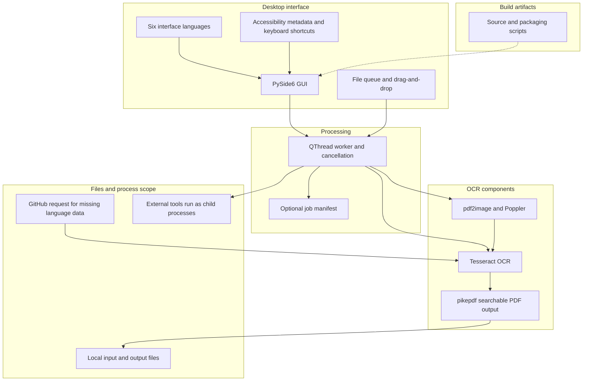

# Архив подробного руководства — исправленная редакция

> Предыдущая версия [README_ru.md](README_ru.md). Основана на исходном коммите 3cfce468f20307bcbc158dd969c3ad304f34b4fe (2026-10-12); текущие утверждения в этой редакции исправлены, это не неизменённая копия. Исходный файл доступен в [этом коммите](https://github.com/doc-bricks/PDFtoPDFocr/blob/3cfce468f20307bcbc158dd969c3ad304f34b4fe/README_ru.md).

---


[English](README.md) | [Deutsch](README_de.md) | [Español](README_es.md) | [中文](README_zh.md) | [日本語](README_ja.md) | [Русский](README_ru.md)

*Перевод выполнен с помощью машинного перевода; приоритетной является английская версия README.*

# PDFtoPDFocr - локальный конвертер PDF с OCR (Local-First)

[](https://www.python.org/)
[](pyproject.toml)
[](LICENSE)
[](https://www.qt.io/)
[](#requirements--platform-matrix)
[](#core-features)
[](NOTICE)
[](llms.txt)
[](https://github.com/doc-bricks)
[](https://github.com/open-bricks)

Преобразует отсканированные PDF-файлы и растровые изображения в PDF с возможностью поиска, используя локальное OCR (оптическое распознавание символов) на базе Tesseract. Поддерживает пакетную обработку файлов разных форматов, выбор языка OCR с автоматической загрузкой языковых пакетов, неразрушающее сохранение исходных файлов, доступные эргономичные элементы интерфейса и интеграцию портативных версий Tesseract/Poppler.

Машиночитаемый контекст проекта: [`llms.txt`](llms.txt) | [Документация на немецком языке](README_de.md) | [Политика безопасности](SECURITY.md)

> [!NOTE]
> **Интеграция с ИИ и LLM:** В этом репозитории есть структурированный файл [`llms.txt`](llms.txt), содержащий машиночитаемый контекст, сведения об архитектуре, интерфейсы CLI/GUI и точки входа для тестов — для автономных агентов и инструментов разработчика.

> [!TIP]
> OCR и сборка PDF выполняются локальными инструментами. Если данных Tesseract для выбранного языка нет, приложение может запросить их у GitHub; доступ к сети на уровне системы не блокируется.

---

## 🧭 Быстрая навигация

1. 📸 [Визуальная витрина и обзор интерфейса](#visual-showcase)
2. 🏛️ [Архитектура системы и 5-уровневая топология](#system-architecture--component-workflow)
3. 🔄 [Локальный поток данных и жизненный цикл OCR-обработки документов](#local-data-flow--privacy-isolation)
4. 🚀 [Быстрый старт и основные операции](#quick-start--key-operations)
5. ✨ [Основные возможности и производительность](#core-features)
6. 🎯 [Назначение](#target-personas--discoverability)
7. ⚖️ [Сравнительная матрица по 10 критериям с 5 альтернативами](#comparative-matrix--alternatives)
8. ⌨️ [Возможности доступности и горячие клавиши](#accessibility--keyboard-shortcuts)
9. 💻 [Требования и матрица платформ](#requirements--platform-matrix)
10. 📦 [Установка и портативная настройка](#installation--portable-setup)
11. 🖥️ [Использование и руководство по запуску](#usage--execution-guidelines)
12. 🧪 [Автоматическое тестирование и проверка качества](#tests--quality-verification)
13. 🌐 [Родственные инструменты и интеграция с экосистемой](#sibling-tools--ecosystem)
14. 📜 [Выбранная информация о сторонних лицензиях](#third-party-licenses--transparency)
15. 🔒 [Область действия сведений о конфиденциальности и безопасности](#privacy--security-model)
16. 🪟 [Упаковка EXE и дистрибутивов (Windows Store MSIX и портативная версия)](#exe--distribution-packaging)
17. 🤖 [Машиночитаемый контекст для LLM (llms.txt)](#machine-readable-llm-context)
18. ⚖️ [Правовое уведомление (§ 521 BGB) и лицензия](#statutory-notice--license)

---

<a id="visual-showcase"></a>
<a id="visuelle-showcase-galerie"></a>
## 📸 Визуальная витрина и обзор интерфейса

| Основной интерфейс | Визуальные ресурсы и фирменный стиль приложения |
|:---:|:---:|
| <br/><sub>**Очередь пакетной конвертации** — приём файлов перетаскиванием, динамический выбор языка, значки статуса элементов в реальном времени и неблокирующий индикатор выполнения рабочего потока.</sub> | <br/><sub>**Фирменный стиль приложения в высоком разрешении** — набор значков пакета MSIX для нативного Windows Store и доступные контрастные палитры.</sub> |

---

<a id="system-architecture--component-workflow"></a>
<a id="systemarchitektur--komponenten-workflow"></a>
<a id="four-view-architectural-topology-projection"></a>
<a id="vier-sichten-architektur-topologie-projektion"></a>
## 🏛️ Архитектура и поток компонентов



### Архитектура в четырёх представлениях

- Интерфейс: GUI PySide6, очередь файлов, шесть языков, метаданные доступности и горячие клавиши.
- Обработка: рабочий поток QThread, отмена и необязательный экспорт манифеста задания.
- OCR: pdf2image/Poppler, нормализация изображений, Tesseract и создание PDF через pikepdf.
- Запуск: дочерние процессы наследуют права запускающего процесса; приложение не создаёт песочницу и не блокирует сеть.

The diagram shows component flow; it does not describe a network filter, sandbox, or license boundary.

<a id="local-data-flow--privacy-isolation"></a>
<a id="lokaler-datenfluss--datenschutz-isolation"></a>
## 🔄 Локальный поток данных и жизненный цикл OCR-обработки документов

```mermaid
sequenceDiagram
    autonumber
    actor User as Пользователь / оператор пакетной обработки
    participant GUI as Настольный GUI на PySide6
    participant Worker as Фоновый рабочий поток
    participant Normalizer as Нормализатор изображений
    participant Poppler as Poppler / pdf2image
    participant Tesseract as Движок Tesseract OCR
    participant Assembler as Сборщик PDF pikepdf
    participant FS as Local Filesystem

    User->>GUI: Добавить PDF или изображения (Drag & Drop / диалог выбора файлов)
    User->>GUI: Выбрать целевой язык OCR (например, deu, eng, fra, spa)
    User->>GUI: Запустить пакетную конвертацию (Ctrl+Return или кнопка)
    GUI->>Worker: Запустить асинхронную задачу конвертации
    loop Для каждого документа в очереди
        alt Входной файл — отсканированный PDF
            Worker->>Poppler: Растеризовать страницы PDF в растровые изображения в памяти
            Poppler-->>Worker: Буферы отрендеренных страниц в высоком разрешении
        else Входной файл — изображение (PNG, JPG, многокадровый TIFF)
            Worker->>Normalizer: Наложить прозрачность на белый фон (альфа-композитинг)
            Normalizer-->>Worker: Стандартизированные кадры RGB
        end
        loop Для каждой страницы / кадра
            Worker->>Tesseract: Извлечь текст и ограничивающие рамки локальным движком
            Tesseract-->>Worker: Вернуть текст OCR и слои hOCR / PDF
        end
        Worker->>Assembler: Внедрить поисковый полнотекстовый слой в структуру PDF
        Assembler->>FS: Сохранить результат как <filename>_ocred.pdf (неразрушающе)
        Worker-->>GUI: Обновить индикатор выполнения и цветной значок статуса
    end
    opt Экспорт портативного манифеста задания
        GUI->>FS: Записать pdftopdfocr-job-v1.json (настройки задания и метаданные файлов)
    end
    Note over User,FS: OCR/PDF обрабатываются локально; для получения недостающих языковых данных может использоваться GitHub.
```

---

<a id="quick-start--key-operations"></a>
<a id="schnelleinstieg--kernabläufe"></a>
## 🚀 Быстрый старт и основные операции

| Задача | Интерфейс / команда | Вывод / результат |
|---|---|---|
| **Запуск настольного приложения** | `python PDFtoPDFocr_2.py` или `START.bat` | Настольный GUI на PySide6 с очередью файлов и поддержкой Drag & Drop |
| **Конвертация отсканированных PDF** | Добавьте файлы, выберите язык, нажмите «Start» (`Ctrl+Return`) | Неразрушающий `*_ocred.pdf` с полнотекстовым поисковым слоем |
| **Прямое OCR изображений** | Перетащите изображения JPG, PNG или многокадровые TIFF | Собранный PDF-документ с возможностью поиска |
| **Объединение в один PDF** | Включите «Auto-Merge» на панели инструментов | Объединённый многодокументный PDF с возможностью поиска |
| **Экспорт манифеста задания** | Нажмите «Job-Export» (`Ctrl+E`) | Портативный манифест `pdftopdfocr-job-v1.json` |
| **Запуск тестов** | <code>python -m pytest</code> | Запускает тестовый набор репозитория |
| **Портативная сборка** | `python build_release.py --clean` | Автономный исполняемый файл в `dist/PDFtoPDFocr/` |

---

<a id="core-features"></a>
<a id="funktionen--features"></a>
## ✨ Основные возможности и производительность

- **Пакетная обработка** — одновременная конвертация нескольких PDF и изображений через диалог выбора файлов или Drag & Drop.
- **Прямой импорт изображений** — сканы JPG, PNG и многокадровые TIFF напрямую преобразуются в PDF с возможностью поиска без дополнительных инструментов.
- **Выбор языка OCR** — быстрый выбор немецкого, английского, французского, испанского и многих десятков других языков.
- **Автоматическая загрузка** — недостающие языковые пакеты Tesseract (`.traineddata`) автоматически загружаются по требованию из официальных репозиториев GitHub.
- **Автообъединение и наложение** — объединение нескольких обработанных результатов OCR в один сводный PDF-документ.
- **Портативные Tesseract и Poppler** — портативные сборки (`python build_release.py`) включают Tesseract и Poppler; при запуске из исходного кода Tesseract и Poppler должны быть установлены или размещены в `tesseract_portable/` и `poppler/` рядом с приложением.
- **Исходный файл сохраняется** — результаты сохраняются с суффиксом `_ocred.pdf` или в настроенной папке вывода; исходные файлы остаются нетронутыми.
- **Экспорт манифеста задания** — сохранение портативных манифестов `pdftopdfocr-job-v1.json` с настройками задания, статусом выполнения и метаданными файлов.
- **Доступность и удобство** — имена и описания элементов, подсказки и сочетания клавиш; независимая проверка WCAG не заявляется.
- **Индикация состояния** — цвет и подсказки для каждого элемента показывают ход обработки.

---

<a id="target-personas--discoverability"></a>
<a id="zielgruppen--auffindbarkeit"></a>
## 🎯 Назначение

PDFtoPDFocr преобразует сканированные PDF и изображения в PDF с поисковым текстом с помощью локального OCR. Отсутствующие языковые данные Tesseract могут запрашиваться у GitHub. Проект не сертифицирует соответствие юридическим, медицинским или нормативным требованиям.

<a id="comparative-matrix--alternatives"></a>
<a id="vergleichsmatrix--alternativen"></a>
## ⚖️ Примечание о сравнениях

Историческая сравнительная таблица отозвана: для каждого альтернативного продукта не было актуальных независимо проверенных данных. Не используйте её как действующее сравнение.

<a id="accessibility--keyboard-shortcuts"></a>
<a id="barrierefreiheit--tastenkürzel"></a>
## ⌨️ Возможности доступности и горячие клавиши

| Действие | Сочетание клавиш | Описание |
|---|---|---|
| **Добавить файлы** | `Ctrl+O` | Открыть диалог выбора файлов |
| **Запустить OCR** | `Ctrl+Return` | Запустить пакетную OCR-обработку |
| **Экспортировать манифест задания** | `Ctrl+E` | Экспортировать состояние задания как манифест JSON |
| **Очистить список и сбросить** | `F5` | Сбросить список файлов и отображение статуса |
| **Выбрать папку вывода** | `Ctrl+Shift+O` | Выбрать пользовательский каталог вывода |
| **Удалить выбранный файл** | `Del` или `Backspace` | Удалить выбранный элемент из очереди |

---

<a id="requirements--platform-matrix"></a>
<a id="voraussetzungen--plattformmatrix"></a>
## 💻 Требования и матрица платформ

- Python 3.10+
- Windows 10/11 (основная целевая платформа выпуска)
- macOS / Linux (цели для исходного кода и дымового тестирования)

---

<a id="installation--portable-setup"></a>
<a id="installation--portables-setup"></a>
## 📦 Установка и портативная настройка

```bash
pip install -r requirements.txt
```

При запуске из исходного кода Tesseract OCR и Poppler должны быть доступны: либо в `PATH` (путь к Tesseract можно также задать через `TESSERACT_CMD`), либо в портативном виде внутри каталога проекта (`tesseract_portable/`, `poppler/`). Недостающие языковые пакеты загружаются автоматически.

---

<a id="usage--execution-guidelines"></a>
<a id="nutzung--ausführungsrichtlinien"></a>
## 🖥️ Использование и руководство по запуску

```bash
python PDFtoPDFocr_2.py
```

В Windows `START.bat` также служит ярлыком запуска приложения двойным щелчком.

1. Добавьте PDF или изображения через диалог выбора файлов или Drag & Drop.
2. Выберите язык OCR (недостающие языковые пакеты загружаются автоматически).
3. Нажмите «Start» — готово.
4. При необходимости воспользуйтесь `Job-Export`, чтобы сохранить портативный манифест `pdftopdfocr-job-v1.json`.

---

<a id="tests--quality-verification"></a>
<a id="tests--qualitätsprüfung"></a>
## 🧪 Автоматическое тестирование и проверка качества

```bash
python -m pip install -r requirements-dev.txt
python -m pytest
```

Набор тестов охватывает:
- **Доступность UI и сочетания клавиш** (`tests/test_ui_accessibility.py`)
- **Конфигурацию Tesseract** (`tests/test_tesseract_config.py`)
- **Формат экспорта задания и схему манифеста** (`tests/test_export_format.py`)
- **Переключение языков и поддержку нескольких языков** (`tests/test_language_switch.py`)
- **Регрессии ошибок и жизненный цикл ресурсов** (`tests/test_bug_regressions.py`)
- **Значки приложения и проверку визуальных ресурсов** (`tests/test_app_assets.py`)
- **Платформенную упаковку и проверку выпуска** (`tests/test_build_release.py`, `tests/test_platform_package_gate.py`)
- **Метаданные, безопасность и управление паритетом** (`tests/test_metadata.py`, `tests/test_security_license_contract.py`)

---

<a id="sibling-tools--ecosystem"></a>
<a id="geschwister-tools--ökosystem"></a>
## 🌐 Родственные инструменты и интеграция с экосистемой

PDFtoPDFocr входит в семейство утилит для работы с документами **doc-bricks** и в более широкую экосистему настольных приложений с открытым исходным кодом **open-bricks**:

| Инструмент | Экосистема | Назначение | Репозиторий |
|---|---|---|---|
| **DokuReader** | `doc-bricks` | Локальная библиотека документов, рабочее пространство для чтения и просмотрщик разных форматов | [doc-bricks/DokuReader](https://github.com/doc-bricks/DokuReader) |
| **MediaBrain** | `doc-bricks` | Локальный инспектор метаданных медиафайлов, анализатор EXIF и пакетный классификатор | [doc-bricks/MediaBrain](https://github.com/doc-bricks/MediaBrain) |
| **UniversalDocsGrabber** | `doc-bricks` | Автоматизированное извлечение документов из почты и конвейер пакетного приёма с OCR | [doc-bricks/UniversalDocsGrabber](https://github.com/doc-bricks/UniversalDocsGrabber) |
| **UniversalInvoiceMail** | `doc-bricks` | Извлечение данных счетов и экспорт CSV в стиле DATEV | [doc-bricks/UniversalInvoiceMail](https://github.com/doc-bricks/UniversalInvoiceMail) |
| **UniversalMailCleaner** | `doc-bricks` | Очистка почтовых ящиков с приоритетом конфиденциальности, отписка от рассылок и безопасная чистка | [doc-bricks/UniversalMailCleaner](https://github.com/doc-bricks/UniversalMailCleaner) |
| **CleanMarkdown** | `doc-bricks` | Санитизация Markdown, форматирование таблиц и линтер документации | [doc-bricks/CleanMarkdown](https://github.com/doc-bricks/CleanMarkdown) |
| **LitZentrum** | `doc-bricks` | Менеджер научной литературы, связыватель цитат BibTeX и рабочее пространство исследователя | [doc-bricks/LitZentrum](https://github.com/doc-bricks/LitZentrum) |
| **MailProcessor** | `doc-bricks` | Локальное архивирование почты по правилам, фильтрация вложений и механизм сортировки | [doc-bricks/MailProcessor](https://github.com/doc-bricks/MailProcessor) |
| **ProFiler** | `file-bricks` | Быстрый поиск файлов по нескольким критериям, фильтрация регулярными выражениями и пакетное переименование | [file-bricks/ProFiler](https://github.com/file-bricks/ProFiler) |
| **ExplorerPro** | `file-bricks` | Двухпанельный настольный файловый менеджер с вкладками, закладками и шестнадцатеричным просмотром | [file-bricks/ExplorerPro](https://github.com/file-bricks/ExplorerPro) |
| **DevCenter** | `dev-bricks` | Менеджер среды разработки, оркестратор набора инструментов и запуск проектов | [dev-bricks/DevCenter](https://github.com/dev-bricks/DevCenter) |
| **CodeBox** | `dev-bricks` | Офлайн-площадка для кода на нескольких языках, органайзер сниппетов и песочница | [dev-bricks/CodeBox](https://github.com/dev-bricks/CodeBox) |
| **open-bricks** | `open-bricks` | Объединяющая организация и отобранный каталог настольных инструментов с приоритетом конфиденциальности | [open-bricks](https://github.com/open-bricks) |

---

<a id="third-party-licenses--transparency"></a>
<a id="drittanbieter-lizenzen--transparenz"></a>
## 📜 Выбранная информация о сторонних лицензиях

В репозитории приведён выбранный перечень сведений о лицензиях зависимостей и включённых инструментов. Это не полный перечень компонентов ПО и не сертификация соответствия требованиям. Обязательства зависят от конкретных компонентов и распространяемых артефактов; запуск инструмента как подпроцесса сам по себе не создаёт юридическую или защитную границу. Лицензия проекта — MIT; лицензии сторонних компонентов рассматриваются отдельно. Доступный перечень приведён в [THIRD_PARTY_LICENSES.md](THIRD_PARTY_LICENSES.md) и [THIRD_PARTY_LICENSES.txt](THIRD_PARTY_LICENSES.txt).

<a id="privacy--security-model"></a>
<a id="datenschutz--sicherheitsmodell"></a>
## 🔒 Область действия сведений о конфиденциальности и безопасности

OCR и сборка PDF выполняются локальными инструментами. Код приложения может запрашивать у GitHub недостающие языковые данные Tesseract. Это не ограничивает сеть на уровне системы. Запущенные процессы наследуют права запускающего процесса; приложение не изолирует их в песочнице. Политика сопровождающих и канал сообщения об уязвимостях описаны в SECURITY.md.

<a id="exe--distribution-packaging"></a>
<a id="exe--distributions-packaging"></a>
## 🪟 Упаковка EXE и дистрибутивов (Windows Store MSIX и портативная версия)

```bash
python build_release.py --clean

# or on Windows via double-click / terminal:
build_exe.bat

# or directly via PyInstaller with dependencies installed:
python -m PyInstaller --noconfirm --clean PDFtoPDFocr.spec
```

Собранный пакет записывается в `dist/PDFtoPDFocr/`. Если каталоги `tesseract_portable/` и `poppler/` присутствуют, они включаются автоматически.

---

<a id="machine-readable-llm-context"></a>
<a id="maschinenlesbarer-llm-kontext"></a>
## 🤖 Машиночитаемый контекст для LLM (llms.txt)

Для автономных ИИ-агентов для написания кода, парного программирования и автоматизированных CI-конвейеров этот репозиторий предоставляет специальный индекс [`llms.txt`](llms.txt), следующий современным соглашениям о контексте для LLM. Он включает:
- Краткое описание архитектуры и роли компонентов
- Команды набора тестов и шлюзы проверки
- Политика сопровождающих и область проверок, описанные в SECURITY.md
- Карту ключевых файлов и матрицы зависимостей

---

<a id="statutory-notice--license"></a>
<a id="contributing--license"></a>
<a id="gesetzlicher-hinweis--lizenz"></a>
<a id="mitwirken--lizenz"></a>
## ⚖️ Лицензия и правовое примечание

Проект предоставляется по лицензии [MIT](LICENSE). Применимость правовых норм, например § 521 BGB, зависит от правоотношений и применимого права; эта документация не устанавливает общего освобождения от ответственности.
