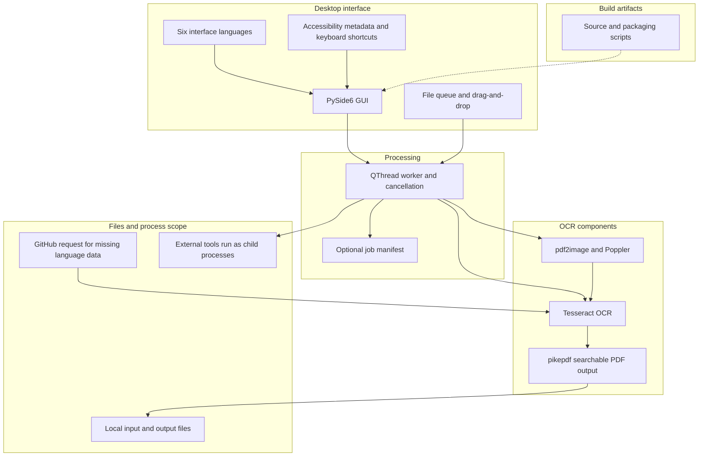
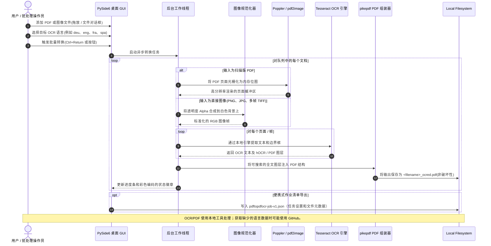

# 详细指南存档 — 声明已校正版

> 这是 [README_zh.md](README_zh.md) 的前一版，基于源提交 3cfce468f20307bcbc158dd969c3ad304f34b4fe（2026-10-12）；本版已校正当前声明，并非未修改的副本。原始版本见[该提交中的 README_zh.md](https://github.com/doc-bricks/PDFtoPDFocr/blob/3cfce468f20307bcbc158dd969c3ad304f34b4fe/README_zh.md)。

---


[English](README.md) | [Deutsch](README_de.md) | [Español](README_es.md) | [中文](README_zh.md) | [日本語](README_ja.md) | [Русский](README_ru.md)

*机器辅助翻译；以英文 README 为准。*

# PDFtoPDFocr - 本地优先的 PDF OCR 转换器

[](https://www.python.org/)
[](pyproject.toml)
[](LICENSE)
[](https://www.qt.io/)
[](#requirements--platform-matrix)
[](#core-features)
[](NOTICE)
[](llms.txt)
[](https://github.com/doc-bricks)
[](https://github.com/open-bricks)

借助 Tesseract 本地 OCR(光学字符识别),将扫描版 PDF 文件和原始图像转换为可搜索的 PDF。支持多格式批量处理、可选择的 OCR 语言及语言包自动下载、对原始文件的非破坏性保留、无障碍的界面人体工学设计,以及便携式 Tesseract/Poppler 集成。

机器可读的项目上下文:[`llms.txt`](llms.txt) | [德语文档](README_de.md) | [安全策略](SECURITY.md)

> [!NOTE]
> **AI 与 LLM 集成:** 本仓库包含结构化的 [`llms.txt`](llms.txt) 文件,为自主代理和开发者工具提供机器可读的上下文、架构细节、CLI/GUI 接口以及测试入口点。

> [!TIP]
> OCR 和 PDF 组装使用本地工具。所选语言缺少 Tesseract 数据时，应用可能从 GitHub 请求数据；这不会限制系统网络访问。

---

## 🧭 快速导航

1. 📸 [视觉展示与界面概览](#visual-showcase)
2. 🏛️ [系统架构与 5 层拓扑](#system-architecture--component-workflow)
3. 🔄 [本地数据流与文档 OCR 处理生命周期](#local-data-flow--privacy-isolation)
4. 🚀 [快速入门与关键操作](#quick-start--key-operations)
5. ✨ [核心功能与性能能力](#core-features)
6. 🎯 [适用范围](#target-personas--discoverability)
7. ⚖️ [比较说明](#comparative-matrix--alternatives)
8. ⌨️ [无障碍功能与键盘快捷键](#accessibility--keyboard-shortcuts)
9. 💻 [系统要求与平台矩阵](#requirements--platform-matrix)
10. 📦 [安装与便携式设置](#installation--portable-setup)
11. 🖥️ [使用与执行指南](#usage--execution-guidelines)
12. 🧪 [自动化测试与质量验证](#tests--quality-verification)
13. 🌐 [姊妹工具与生态系统集成](#sibling-tools--ecosystem)
14. 📜 [第三方许可证信息（选录）](#third-party-licenses--transparency)
15. 🔒 [隐私与安全范围](#privacy--security-model)
16. 🪟 [EXE 与分发打包(Windows Store MSIX 与便携版)](#exe--distribution-packaging)
17. 🤖 [机器可读的 LLM 上下文(llms.txt)](#machine-readable-llm-context)
18. ⚖️ [法定声明(§ 521 BGB)与许可证](#statutory-notice--license)

---

<a id="visual-showcase"></a>
<a id="visuelle-showcase-galerie"></a>
## 📸 视觉展示与界面概览

| 主界面 | 视觉资源与应用标识 |
|:---:|:---:|
| <br/><sub>**批量转换队列** — 拖放式文件导入、动态语言选择、实时的逐项状态徽章以及非阻塞的工作线程进度。</sub> | <br/><sub>**高分辨率应用标识** — 原生 Windows Store、MSIX 软件包图标集以及无障碍对比度配色。</sub> |

---

<a id="system-architecture--component-workflow"></a>
<a id="systemarchitektur--komponenten-workflow"></a>
<a id="four-view-architectural-topology-projection"></a>
<a id="vier-sichten-architektur-topologie-projektion"></a>
## 🏛️ 架构与组件流程



### 四个视角的架构概览

- 界面：PySide6 GUI、文件队列、六种界面语言、无障碍元数据和快捷键。
- 处理：QThread 工作线程、取消操作以及可选的任务清单导出。
- OCR：pdf2image/Poppler、图像规范化、Tesseract 和 pikepdf PDF 输出。
- 运行：子进程继承启动进程的权限；应用不提供沙箱，也不阻止网络访问。

The diagram shows component flow; it does not describe a network filter, sandbox, or license boundary.

<a id="local-data-flow--privacy-isolation"></a>
<a id="lokaler-datenfluss--datenschutz-isolation"></a>
## 🔄 本地数据流与文档 OCR 处理生命周期



---

<a id="quick-start--key-operations"></a>
<a id="schnelleinstieg--kernabläufe"></a>
## 🚀 快速入门与关键操作

| 任务 | 界面 / 命令 | 输出 / 结果 |
|---|---|---|
| **启动桌面应用** | `python PDFtoPDFocr_2.py` 或 `START.bat` | 带有拖放文件队列的 PySide6 桌面 GUI |
| **转换扫描版 PDF** | 添加文件,选择语言,点击 "Start"(`Ctrl+Return`) | 带有全文搜索图层的非破坏性 `*_ocred.pdf` |
| **直接图像 OCR** | 拖入 JPG、PNG 或多帧 TIFF 图像 | 组装完成的可搜索 PDF 文档 |
| **合并为单个 PDF** | 在工具栏中启用 "Auto-Merge" | 合并后的多文档可搜索 PDF |
| **导出作业清单** | 点击 "Job-Export"(`Ctrl+E`) | 便携式 `pdftopdfocr-job-v1.json` 清单 |
| **运行测试** | <code>python -m pytest</code> | 运行仓库测试套件 |
| **便携式构建** | `python build_release.py --clean` | `dist/PDFtoPDFocr/` 中的独立可执行文件 |

---

<a id="core-features"></a>
<a id="funktionen--features"></a>
## ✨ 核心功能与性能能力

- **批量处理** — 通过文件选择器或拖放同时转换多个 PDF 和图像。
- **直接导入图像** — 无需额外工具,即可将 JPG、PNG 和多帧 TIFF 扫描件直接转换为可搜索的 PDF。
- **可选择的 OCR 语言** — 可快速选择德语、英语、法语、西班牙语以及数十种其他语言。
- **自动下载** — 缺失的 Tesseract 语言包(`.traineddata`)会按需从官方 GitHub 仓库自动下载。
- **自动合并与堆叠** — 将多个已处理的 OCR 结果合并为单个 PDF 文档。
- **便携式 Tesseract 与 Poppler** — 便携式构建(`python build_release.py`)内置 Tesseract 和 Poppler;从源码运行时,必须安装 Tesseract 和 Poppler,或将其放置在应用旁边的 `tesseract_portable/` 和 `poppler/` 中。
- **保留原始文件** — 结果以 `_ocred.pdf` 后缀保存,或保存到配置的输出文件夹;源文件保持不变。
- **作业清单导出** — 保存便携式 `pdftopdfocr-job-v1.json` 清单,其中包含作业设置、执行状态和文件元数据。
- **完整的无障碍(A11y)与人体工学** — 所有控件均提供屏幕阅读器可访问的名称和描述、使用当前语言的信息性工具提示,以及完整的键盘快捷键(`Ctrl+O`、`Ctrl+Return`、`Ctrl+E`、`F5`、`Ctrl+Shift+O`、`Del`/`Backspace`)。
- **状态显示** — 通过颜色和工具提示显示各项目的处理状态。

---

<a id="target-personas--discoverability"></a>
<a id="zielgruppen--auffindbarkeit"></a>
## 🎯 适用范围

PDFtoPDFocr 使用本地 OCR 将扫描 PDF 和图像转换为可搜索 PDF。缺少的 Tesseract 语言数据可能从 GitHub 请求。本项目不认证其符合法律、医疗或监管要求。

<a id="comparative-matrix--alternatives"></a>
<a id="vergleichsmatrix--alternativen"></a>
## ⚖️ 比较说明

历史比较表因缺少对每个替代产品的当前独立核实依据而撤回。请勿将其视为当前产品比较。

<a id="accessibility--keyboard-shortcuts"></a>
<a id="barrierefreiheit--tastenkürzel"></a>
## ⌨️ 无障碍功能与键盘快捷键

| 操作 | 快捷键 | 说明 |
|---|---|---|
| **添加文件** | `Ctrl+O` | 打开文件选择对话框 |
| **开始 OCR** | `Ctrl+Return` | 开始批量 OCR 处理 |
| **导出作业清单** | `Ctrl+E` | 将作业状态导出为 JSON 清单 |
| **清空列表并重置** | `F5` | 重置文件列表和状态显示 |
| **选择输出文件夹** | `Ctrl+Shift+O` | 选择自定义输出目录 |
| **移除所选文件** | `Del` 或 `Backspace` | 将所选条目从队列中移除 |

---

<a id="requirements--platform-matrix"></a>
<a id="voraussetzungen--plattformmatrix"></a>
## 💻 系统要求与平台矩阵

- Python 3.10+
- Windows 10/11(主要发布目标)
- macOS / Linux(源码与冒烟测试目标)

---

<a id="installation--portable-setup"></a>
<a id="installation--portables-setup"></a>
## 📦 安装与便携式设置

```bash
pip install -r requirements.txt
```

从源码运行时,Tesseract OCR 和 Poppler 必须可用:要么位于 `PATH` 中(Tesseract 也可通过 `TESSERACT_CMD` 设置),要么以便携方式放在项目目录内(`tesseract_portable/`、`poppler/`)。缺失的语言包会自动下载。

---

<a id="usage--execution-guidelines"></a>
<a id="nutzung--ausführungsrichtlinien"></a>
## 🖥️ 使用与执行指南

```bash
python PDFtoPDFocr_2.py
```

在 Windows 上,`START.bat` 也可作为双击启动的桌面启动器。

1. 通过文件选择器或拖放添加 PDF 或图像。
2. 选择 OCR 语言(缺失的语言包会自动下载)。
3. 点击 "Start" — 完成。
4. 可选:使用 `Job-Export` 保存便携式 `pdftopdfocr-job-v1.json` 清单。

---

<a id="tests--quality-verification"></a>
<a id="tests--qualitätsprüfung"></a>
## 🧪 自动化测试与质量验证

```bash
python -m pip install -r requirements-dev.txt
python -m pytest
```

测试套件涵盖:
- **UI 无障碍与快捷键**(`tests/test_ui_accessibility.py`)
- **Tesseract 配置**(`tests/test_tesseract_config.py`)
- **作业导出格式与清单模式**(`tests/test_export_format.py`)
- **语言切换与多语言支持**(`tests/test_language_switch.py`)
- **缺陷回归与资源生命周期**(`tests/test_bug_regressions.py`)
- **应用图标与视觉资源验证**(`tests/test_app_assets.py`)
- **平台打包与发布验证**(`tests/test_build_release.py`、`tests/test_platform_package_gate.py`)
- **元数据、安全与一致性治理**(`tests/test_metadata.py`、`tests/test_security_license_contract.py`)

---

<a id="sibling-tools--ecosystem"></a>
<a id="geschwister-tools--ökosystem"></a>
## 🌐 姊妹工具与生态系统集成

PDFtoPDFocr 是 **doc-bricks** 文档实用工具家族以及更广泛的 **open-bricks** 开源桌面生态系统的一部分:

| 工具 | 生态系统 | 用途 | 仓库 |
|---|---|---|---|
| **DokuReader** | `doc-bricks` | 本地文档库、阅读工作区与跨格式查看器 | [doc-bricks/DokuReader](https://github.com/doc-bricks/DokuReader) |
| **MediaBrain** | `doc-bricks` | 本地媒体元数据检查器、EXIF 分析器与批量分类器 | [doc-bricks/MediaBrain](https://github.com/doc-bricks/MediaBrain) |
| **UniversalDocsGrabber** | `doc-bricks` | 自动化电子邮件文档提取器与 OCR 批量导入流水线 | [doc-bricks/UniversalDocsGrabber](https://github.com/doc-bricks/UniversalDocsGrabber) |
| **UniversalInvoiceMail** | `doc-bricks` | 发票提取与 DATEV 风格 CSV 导出 | [doc-bricks/UniversalInvoiceMail](https://github.com/doc-bricks/UniversalInvoiceMail) |
| **UniversalMailCleaner** | `doc-bricks` | 隐私优先的邮箱清理器、新闻简报退订器与安全清除器 | [doc-bricks/UniversalMailCleaner](https://github.com/doc-bricks/UniversalMailCleaner) |
| **CleanMarkdown** | `doc-bricks` | Markdown 清理、表格格式化与文档检查器 | [doc-bricks/CleanMarkdown](https://github.com/doc-bricks/CleanMarkdown) |
| **LitZentrum** | `doc-bricks` | 学术文献管理器、BibTeX 引文绑定器与研究工作区 | [doc-bricks/LitZentrum](https://github.com/doc-bricks/LitZentrum) |
| **MailProcessor** | `doc-bricks` | 基于规则的本地邮件归档、附件过滤与分拣引擎 | [doc-bricks/MailProcessor](https://github.com/doc-bricks/MailProcessor) |
| **ProFiler** | `file-bricks` | 快速多条件文件搜索、正则过滤与批量重命名 | [file-bricks/ProFiler](https://github.com/file-bricks/ProFiler) |
| **ExplorerPro** | `file-bricks` | 带标签页、书签和十六进制预览的双窗格桌面文件管理器 | [file-bricks/ExplorerPro](https://github.com/file-bricks/ExplorerPro) |
| **DevCenter** | `dev-bricks` | 开发环境管理器、工具链编排器与项目启动器 | [dev-bricks/DevCenter](https://github.com/dev-bricks/DevCenter) |
| **CodeBox** | `dev-bricks` | 离线多语言代码试验场、代码片段整理器与沙盒 | [dev-bricks/CodeBox](https://github.com/dev-bricks/CodeBox) |
| **open-bricks** | `open-bricks` | 伞形组织与隐私优先桌面工具的精选目录 | [open-bricks](https://github.com/open-bricks) |

---

<a id="third-party-licenses--transparency"></a>
<a id="drittanbieter-lizenzen--transparenz"></a>
## 📜 第三方许可证信息（选录）

本仓库列出了部分依赖项和随附工具的许可证信息。这不是完整的软件物料清单，也不是合规认证。义务取决于具体组件和发行制品；仅以子进程方式运行工具并不构成法律或安全边界。项目本身采用 MIT 许可证；第三方组件许可证另行适用。现有清单见 [THIRD_PARTY_LICENSES.md](THIRD_PARTY_LICENSES.md) 和 [THIRD_PARTY_LICENSES.txt](THIRD_PARTY_LICENSES.txt)。

<a id="privacy--security-model"></a>
<a id="datenschutz--sicherheitsmodell"></a>
## 🔒 隐私与安全范围

OCR 和 PDF 组装使用本地工具。应用代码可能从 GitHub 请求缺少的 Tesseract 语言数据。这不会限制整个系统的网络访问。启动的进程继承启动进程的权限；应用不会将其隔离在沙箱中。维护者政策和报告渠道见 SECURITY.md。

<a id="exe--distribution-packaging"></a>
<a id="exe--distributions-packaging"></a>
## 🪟 EXE 与分发打包(Windows Store MSIX 与便携版)

```bash
python build_release.py --clean

# or on Windows via double-click / terminal:
build_exe.bat

# or directly via PyInstaller with dependencies installed:
python -m PyInstaller --noconfirm --clean PDFtoPDFocr.spec
```

打包后的构建输出写入 `dist/PDFtoPDFocr/`。如果存在 `tesseract_portable/` 和 `poppler/`,它们会被自动打包。

---

<a id="machine-readable-llm-context"></a>
<a id="maschinenlesbarer-llm-kontext"></a>
## 🤖 机器可读的 LLM 上下文(llms.txt)

针对自主 AI 编码代理、结对编程伙伴和自动化 CI 流水线,本仓库提供了遵循现代 LLM 上下文约定的专用 [`llms.txt`](llms.txt) 索引。其中包括:
- 架构摘要与组件职责
- 测试套件命令与验证关卡
- SECURITY.md 中的维护者政策与测试范围
- 关键文件映射与依赖矩阵

---

<a id="statutory-notice--license"></a>
<a id="contributing--license"></a>
<a id="gesetzlicher-hinweis--lizenz"></a>
<a id="mitwirken--lizenz"></a>
## ⚖️ 许可证与法律说明

本项目依据 [MIT 许可证](LICENSE)提供。§ 521 BGB 等法定规则是否适用，取决于具体法律关系和适用法律；本文档不作一概免责的说明。
